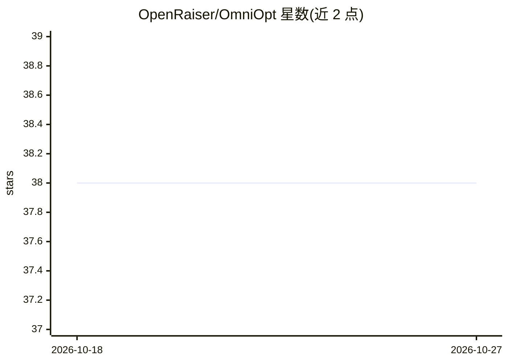

# OpenRaiser/OmniOpt

⭐ 38 · Python · 推送 2026-07-07 · [GitHub](https://github.com/OpenRaiser/OmniOpt) · [官网](https://openraiser.github.io/OmniOpt/) · 组织维护 · 中文 README

**面向 LLM 预训练的现代优化器两阶段评测基准**

系统性比较 LLM 预训练优化器的两阶段基准：Stage 1 在 C4 数据集上以 LLaMA-3 架构在 60M–1B 四个规模扫测 24+ 种优化器（AdamW、Muon、Shampoo、SOAP 等），以最终验证困惑度筛选；Stage 2 将胜出者迁移到 FineWeb-Edu（32k 序列），跨 Transformer++/GLA/DeltaNet/Gated DeltaNet 四种架构验证泛化。采用受控变量协议：每优化器仅调 lr/betas/eps 等自身超参，架构、数据与调度固定。提供 pip/conda 环境配置与 torchrun 启动脚本，面向深度学习研究人员。

## 筛选速览

| 维度 | 判定 | 备注 |
|---|---|---|
| AI 角色 | `ai-ecosystem` | LLM/agent 周边工具 |
| 许可风险 | `none` | — |
| 部署形态 | `library` | 以包/库形式分发 |
| 模型依赖 | — | README 未给出锁定关系 |
| 硬件要求 | — | 无带数字的原话,不猜 |
| 安装摩擦 | `low` | 无编译、无系统依赖或容器化 |
| 成熟度 | — | 结构信号不足 |

## 能力要点

- Stage 1 在 C4/LLaMA-3 上扫测 24+ 种优化器（60M/130M/350M/1B 四规模）
- Stage 2 在 FineWeb-Edu 32k 序列上跨四种架构（Transformer++/GLA/DeltaNet/Gated DeltaNet）验证
- 受控变量协议：仅调优化器自身超参，其余设置固定
- 提供两阶段训练入口脚本与训练协议表

## 适用场景

- 为 LLM 预训练选型优化器时查阅跨规模、跨架构的对比结果
- 复现各优化器在统一协议下的基准实验
- 按论文引用方式在自己的优化器研究中使用该基准协议

## 场景标签

`模型评测` · 领域:评测与运维

## 证据(README 行号)

> L3: A systematic two-stage benchmark comparing optimizers for LLM pre-training at scale.
> L5: **Stage 1 (Broad Screening)** sweeps 24+ optimizers on C4 under the LLaMA-3 architecture at four scales — 60M, 130M,

## 星数曲线

2026-10-18 38 → 2026-10-27 38（+0）

---
*卡片 v1 · prompt 1.4 · 生成 2026-10-25 · 置信度 high · 依据 README sha `2beae816308b` · [字段定义](../../DATASET.md)*
