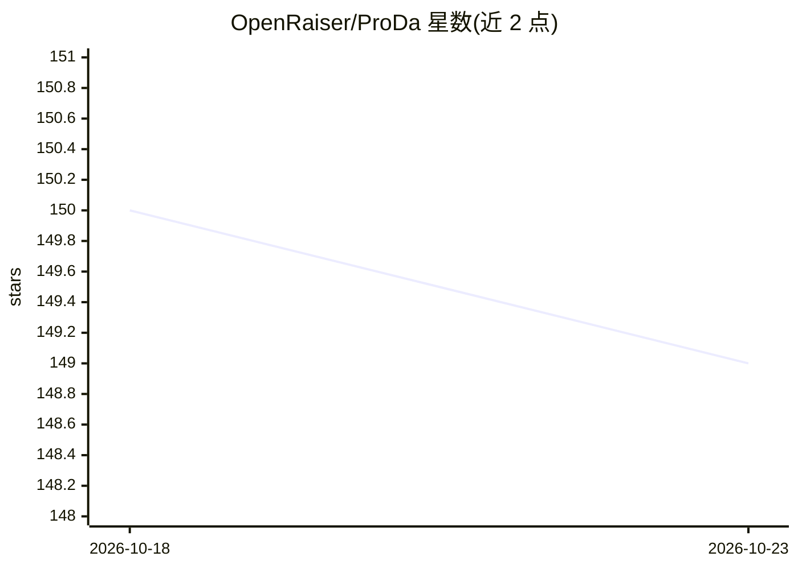

# OpenRaiser/ProDa

⭐ 149 · TypeScript · 推送 2026-06-12 · [GitHub](https://github.com/OpenRaiser/ProDa) · [官网](https://openraiser.github.io/ProDa/) · 组织维护 · 中文 README

**垂直领域 AI 数据构建与模型迭代一站式 Web IDE**

面向垂直领域模型迭代的 VSCode 风格 Web 工作台（FastAPI 后端 + React 前端）：从上传领域文档抽取三层知识结构（概念/陈述/推理链），生成 MCQ Benchmark 与 SFT 训练数据，调用 LLaMA-Factory 做本地微调，经 OpenCompass 评测后基于错误样本生成诊断报告与补数据，支持二轮训练闭环，并可与已训练模型/checkpoint 流式对话验证。依赖外部仓库 LLaMA-Factory 与 OpenCompass，需手动放置并按官方文档安装、执行补丁脚本。

## 筛选速览

| 维度 | 判定 | 备注 |
|---|---|---|
| AI 角色 | `ai-ecosystem` | LLM/agent 周边工具 |
| 许可风险 | `none` | — |
| 部署形态 | `library` | 以包/库形式分发 |
| 模型依赖 | — | README 未给出锁定关系 |
| 硬件要求 | — | 无带数字的原话,不猜 |
| 安装摩擦 | `low` | 无编译、无系统依赖或容器化 |
| 成熟度 | — | 结构信号不足 |

## 能力要点

- 文档到 L1/L2/L3 三层知识结构抽取，支持 pdf/txt/md/docx
- Benchmark 生成、SFT 数据生成、微调、评测、诊断补数据的闭环工作流
- 对接 LLaMA-Factory 微调与 OpenCompass 评测（含样本级错误标注）
- 支持 LoRA/PEFT 识别与 checkpoint 流式对话验证

## 适用场景

- 把领域文档转成可训练的 Benchmark 与 SFT 数据
- 在可视化界面里完成微调、评测与错误诊断迭代
- 基于评测错误样本生成补数据做二轮训练

## 场景标签

`模型评测` `微调` `文档解析` · 领域:评测与运维

## 证据(README 行号)

> L17: > ProDa 不是一个“数据生成脚本集合”，而是一个真正面向模型迭代的 **VSCode 风格 Web IDE**。
> L56: |模型微调|调用 LLaMA-Factory 训练模型|Checkpoint / LoRA 产物|
> L91: - 对接 LLaMA-Factory
> L99: - 支持本地模型和 API 模型

## 星数曲线

2026-10-18 150 → 2026-10-23 149（-1）

---
*卡片 v1 · prompt 1.4 · 生成 2026-10-22 · 置信度 high · 依据 README sha `d3026305526b` · [字段定义](../../DATASET.md)*
