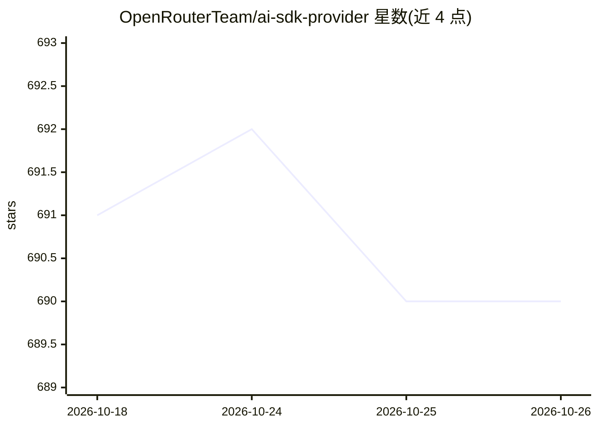

# OpenRouterTeam/ai-sdk-provider

⭐ 690 · TypeScript · Apache-2.0 · 推送 2026-10-23 · [GitHub](https://github.com/OpenRouterTeam/ai-sdk-provider) · [官网](https://www.npmjs.com/package/@openrouter/ai-sdk-provider) · 组织维护

**让 Vercel AI SDK 接入 OpenRouter 300+ 模型的 provider 包**

OpenRouter 官方维护的 Vercel AI SDK provider：通过 OpenRouter chat/completion API 提供对 300 余个大模型的访问，支持嵌入模型（含批量）、基于 Decisions API 的评测模型（decisionModel/evaluationModel）、三种 extraBody 传参方式、Anthropic 提示缓存与 beta 功能透传、Response Healing JSON 修复插件、调试模式与用量统计（含 BYOK）。当前发行线支持 ai@^7、需 Node.js 22+、仅 ESM；v5/v6 为 LEGACY 安装。Decisions API 处于 alpha。

## 筛选速览

| 维度 | 判定 | 备注 |
|---|---|---|
| AI 角色 | `ai-ecosystem` | LLM/agent 周边工具 |
| 许可风险 | `permissive` | Apache-2.0 |
| 部署形态 | `library` | 以包/库形式分发 |
| 模型依赖 | locked-api |  |
| 硬件要求 | — | 无带数字的原话,不猜 |
| 安装摩擦 | `low` | 无编译、无系统依赖或容器化 |
| 成熟度 | `idea` | |

## 能力要点

- 通过 OpenRouter API 访问 300+ 大模型与嵌入模型
- 基于 Decisions API 的 AI SDK 评测模型实现
- Anthropic 提示缓存与 fine-grained tool streaming 等特性透传
- 调试模式回显请求体、用量统计与 BYOK 成本跟踪

## 适用场景

- 在 Vercel AI SDK 应用中统一调用 OpenRouter 上的多家模型
- 通过一个 provider 做 LLM 评测与决策查询
- 排查经 OpenRouter 转发后的请求体与 token 用量

## 场景标签

`模型网关` · 领域:Agent 开发

## 证据(README 行号)

> L3: # OpenRouter Provider for Vercel AI SDK
> L5: The OpenRouter provider for the Vercel AI SDK gives access to over 300 large language models on the OpenRouter chat 

## 星数曲线

2026-10-18 691 → 2026-10-26 690（-1）

---
*卡片 v1 · prompt 1.4 · 生成 2026-10-21 · 置信度 high · 依据 README sha `30a86a1273b8` · [字段定义](../../DATASET.md)*
