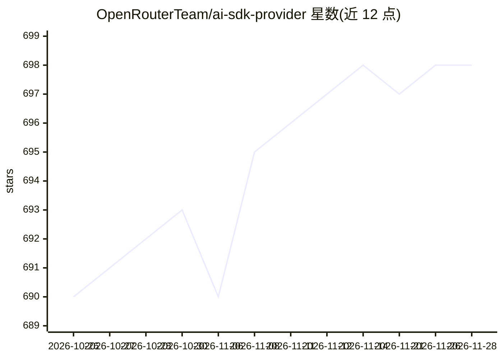

# OpenRouterTeam/ai-sdk-provider

⭐ 698 · TypeScript · Apache-2.0 · 推送 2026-11-23 · [GitHub](https://github.com/OpenRouterTeam/ai-sdk-provider) · [官网](https://www.npmjs.com/package/@openrouter/ai-sdk-provider) · 组织维护

**给 Vercel AI SDK 接入 OpenRouter 数百个模型的提供者包**

OpenRouter 官方维护的 Vercel AI SDK provider 包，通过 OpenRouter 的 chat 与 completion API 接入 300+ 大语言模型。npm 安装后以 `openrouter` 默认实例或 `createOpenRouter` 工厂使用。功能覆盖：文本生成/流式生成、嵌入与批量嵌入、rerank、音频转录与语音生成、Decisions 决策模型（alpha）、路由偏好浅合并与 extraBody 三级传递、多模态图像/视频输入、Anthropic 提示缓存与 beta 头部透传。要求 Node.js 22+，仅支持 ESM，AI SDK v7 起；v5/v6 走 legacy 版本线。

## 筛选速览

| 维度 | 判定 | 备注 |
|---|---|---|
| AI 角色 | `ai-ecosystem` | LLM/agent 周边工具 |
| 许可风险 | `permissive` | Apache-2.0 |
| 部署形态 | `library` | 以包/库形式分发 |
| 模型依赖 | locked-api |  |
| 硬件要求 | — | 无带数字的原话,不猜 |
| 安装摩擦 | `low` | 无编译、无系统依赖或容器化 |
| 成熟度 | `idea` | |

## 能力要点

- 通过 OpenRouter chat/completion API 接入 300+ 模型
- 支持嵌入、批量嵌入、rerank、转录与语音生成端点
- Provider 路由偏好多级浅合并与 extraBody 三种传递方式
- 多模态输入（imageDetail/videoProcessing）与 Anthropic 提示缓存、beta 头部

## 适用场景

- 在 Vercel AI SDK 应用中通过单一接口调用多个厂商模型
- 为 RAG 管道接入语义搜索嵌入模型
- 接入音频转录与语音生成能力
- 按价格/顺序偏好配置模型路由与回退策略

## 场景标签

`模型网关` · 领域:Agent 开发

## 证据(README 行号)

> L3: # OpenRouter Provider for Vercel AI SDK
> L5: The OpenRouter provider for the Vercel AI SDK gives access to over 300 large language models on the OpenRouter chat 
> L9: This release line supports `ai@^7.0.144`, requires Node.js 22 or newer, and is ESM-only.

## 星数曲线

2026-10-26 690 → 2026-11-28 698（+8）

---
*卡片 v1 · prompt 1.4 · 生成 2026-11-24 · 置信度 high · 依据 README sha `1aa11b2e9c7a` · [字段定义](../../DATASET.md)*
