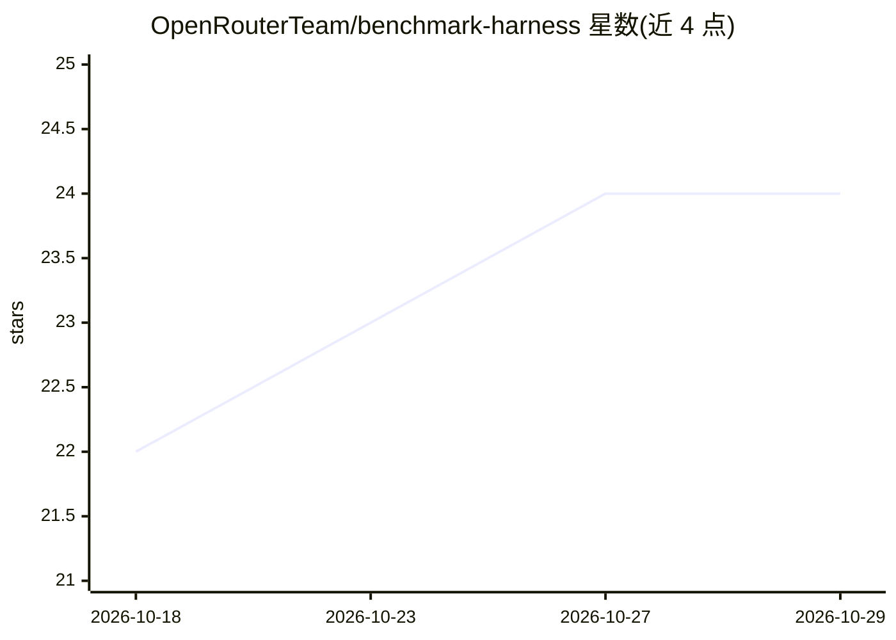

# OpenRouterTeam/benchmark-harness

⭐ 24 · TypeScript · Apache-2.0 · 推送 2026-10-27 · [GitHub](https://github.com/OpenRouterTeam/benchmark-harness) · [官网](https://openrouter.ai) · 组织维护

**OpenRouter 的 LLM 基准评测运行框架，用于可复现测试**

OpenRouter 将其内部基准测试框架开源以保持透明：把各类基准移植到框架中，在其基础设施上可扩展地运行并迭代。通过 bun 安装，以 CLI 指定基准名（如 gpqa_diamond）、模型与条数上限即可运行。支持 Jev Router 的 low/medium/high 成本层级选择，--cost-tier 亦适用于 openrouter/auto 与 auto-beta（经各自 plugin ID 传递）；成本层级与推理力度是独立设置。内置 mini_swe 与 pi sandbox agent 转发层级参数，无法转发 plugins 的 agent 会拒绝显式层级而非静默使用默认值。

## 筛选速览

| 维度 | 判定 | 备注 |
|---|---|---|
| AI 角色 | `ai-ecosystem` | LLM/agent 周边工具 |
| 许可风险 | `permissive` | Apache-2.0 |
| 部署形态 | `None` |  |
| 模型依赖 | locked-api |  |
| 硬件要求 | — | 无带数字的原话,不猜 |
| 安装摩擦 | `low` | 无编译、无系统依赖或容器化 |
| 成熟度 | — | 结构信号不足 |

## 能力要点

- bun run bench CLI 指定基准/模型/条数运行评测
- Jev Router 成本层级（low/medium/high）经 plugins 传递
- --cost-tier 兼容 openrouter/auto 与 auto-beta 的各自 plugin ID
- mini_swe agent 与 pi sandbox agent 转发成本层级参数

## 适用场景

- 在 OpenRouter 上规模化运行移植后的 LLM 基准测试
- 按成本层级对比不同路由配置的模型表现
- 对 SWE Atlas / Deep SWE 类任务运行 agent 基准

## 场景标签

`模型评测` · 领域:评测与运维

## 证据(README 行号)

> L1: # OpenRouter Benchmark Harness
> L3: OpenRouter's internal benchmarking harness, externalized for transparency. We port benchmarks here so we can run the
> L7: OPENROUTER_API_KEY=... bun run bench -- --benchmark gpqa_diamond --model openai/gpt-4o-mini --limit 5

## 星数曲线

2026-10-18 22 → 2026-10-29 24（+2）

---
*卡片 v1 · prompt 1.4 · 生成 2026-10-27 · 置信度 high · 依据 README sha `4e7ab2134564` · [字段定义](../../DATASET.md)*
