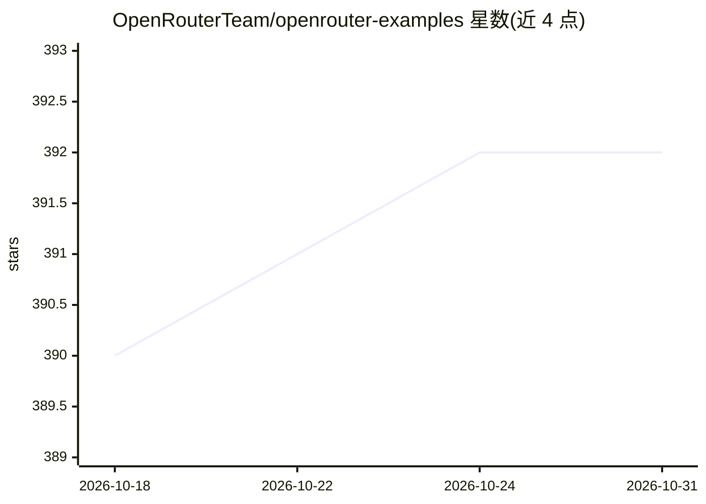

# OpenRouterTeam/openrouter-examples

⭐ 392 · TypeScript · MIT · 推送 2026-03-30 · [GitHub](https://github.com/OpenRouterTeam/openrouter-examples) · [官网](https://openrouter.ai/docs) · 组织维护

**OpenRouter API 集成的可执行示例代码集，覆盖多技术栈**

OpenRouter 官方团队维护的示例仓库：以可运行、经过验证的代码示例演示 OpenRouter API 的各项功能（如 Prompt Caching），覆盖 curl、TypeScript（Bun monorepo，含 fetch/AI SDK/Effect 等生态）多种技术栈。要求 Bun 运行时与 OpenRouter API key，curl 示例另需 jq；通过 make 或 bun install 安装依赖后按 make examples 等命令运行。面向希望接入 OpenRouter 的开发者与进行集成的工程团队。

## 筛选速览

| 维度 | 判定 | 备注 |
|---|---|---|
| AI 角色 | `ai-knowledge` | 知识聚合/清单类 |
| 许可风险 | `permissive` | MIT |
| 部署形态 | `None` |  |
| 模型依赖 | locked-api |  |
| 硬件要求 | — | 无带数字的原话,不猜 |
| 安装摩擦 | `medium` | 含编译或系统依赖之一 |
| 成熟度 | — | 结构信号不足 |

## 能力要点

- 覆盖 curl 与 TypeScript（fetch / AI SDK / Effect）多技术栈的可执行示例
- 示例均经过验证，附预期输出与核验说明
- TypeScript 部分以 Bun workspaces 组织，共享常量与类型

## 适用场景

- 接入 OpenRouter API 时参考现成代码示例
- 学习 Prompt Caching 等功能在所选技术栈中的用法
- 为新项目挑选与自身技术栈匹配的集成模式

## 场景标签

`教程课程` · 领域:学习与行业

## 证据(README 行号)

> L3: Comprehensive, tested, executable examples demonstrating OpenRouter features across multiple ecosystems.
> L18: ├── curl/              - Shell script examples

## 星数曲线

2026-10-18 390 → 2026-10-31 392（+2）

---
*卡片 v1 · prompt 1.4 · 生成 2026-10-21 · 置信度 high · 依据 README sha `a87f0ac458d6` · [字段定义](../../DATASET.md)*
