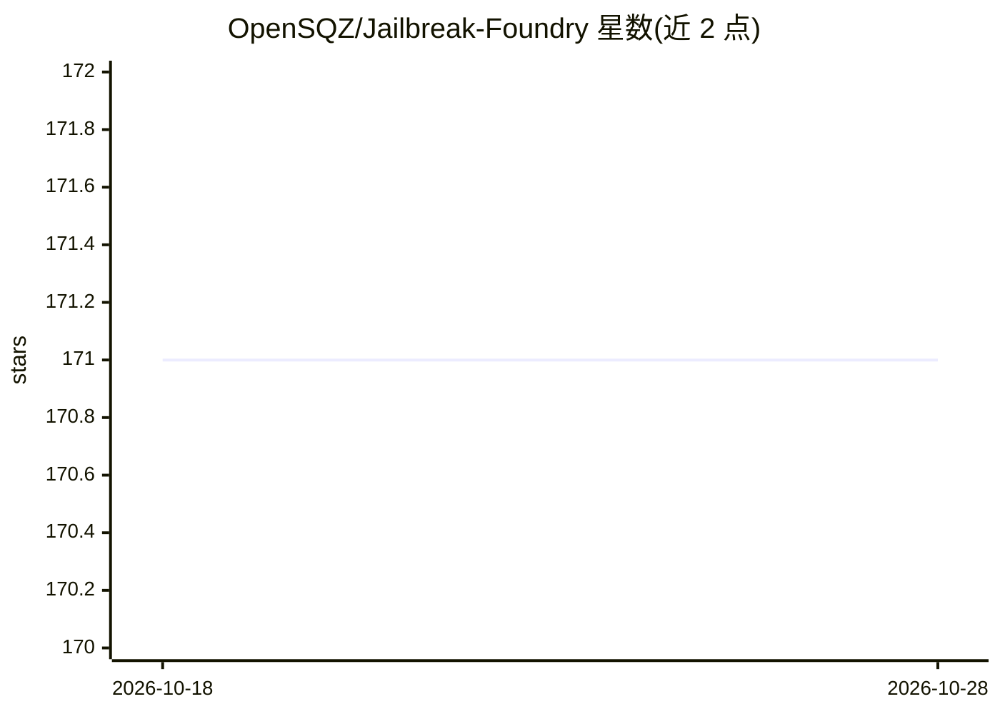

# OpenSQZ/Jailbreak-Foundry

⭐ 172 · Python · 推送 2026-10-08 · [GitHub](https://github.com/OpenSQZ/Jailbreak-Foundry) · 组织维护 · 中文 README

**将越狱论文自动转为可运行攻击并统一评测的基准系统**

面向 AI 安全研究者的越狱攻击复现与评测系统：由 Planner/Coder/Auditor 多智能体工作流（JBF-FORGE）将论文自动翻译为遵循统一契约的攻击模块（平均 28.2 分钟），已复现 30 种攻击、覆盖 10 个受害模型，在 AdvBench/JailbreakBench/HarmBench 数据集上以 GPT-4o 判定的统一协议计算 ASR。共享库 JBF-LIB 提供注册、LLM 适配器与并发执行，攻击特定代码占比 17.5%；另含持续发现新研究的自动化管线。通过 git clone 源码安装，Python 运行。

## 筛选速览

| 维度 | 判定 | 备注 |
|---|---|---|
| AI 角色 | `ai-ecosystem` | LLM/agent 周边工具 |
| 许可风险 | `none` | — |
| 部署形态 | `None` |  |
| 模型依赖 | locked-api |  |
| 硬件要求 | — | 无带数字的原话,不猜 |
| 安装摩擦 | `low` | 无编译、无系统依赖或容器化 |
| 成熟度 | — | 结构信号不足 |

## 能力要点

- 论文→可运行攻击模块的多智能体自动翻译（平均 28.2 分钟）
- 30 种攻击 × 10 个受害模型的统一评测框架
- 复现保真度：30 种攻击平均 ASR 偏差 +0.26pp
- 支持自定义攻击的自动发现与手动实现两种扩展方式

## 适用场景

- 复现和统一比较越狱攻击在不同模型上的 ASR
- 把新发表的越狱论文快速转化为可运行的评测模块
- 跟踪各受害模型对不同攻击机制的鲁棒性差异

## 场景标签

`多智能体` `模型评测` · 领域:Agent 开发

## 证据(README 行号)

> L9: A system that translates jailbreak research papers into executable attack modules and evaluates them under a unified
> L83: Unified evaluation harness for comparable cross-attack and cross-model results:
> L85: - **Consistent Judging**: GPT-4o judge with standardized rubric

## 星数曲线

2026-10-18 171 → 2026-10-28 171（+0）

---
*卡片 v1 · prompt 1.4 · 生成 2026-10-22 · 置信度 high · 依据 README sha `076342dac7d1` · [字段定义](../../DATASET.md)*
