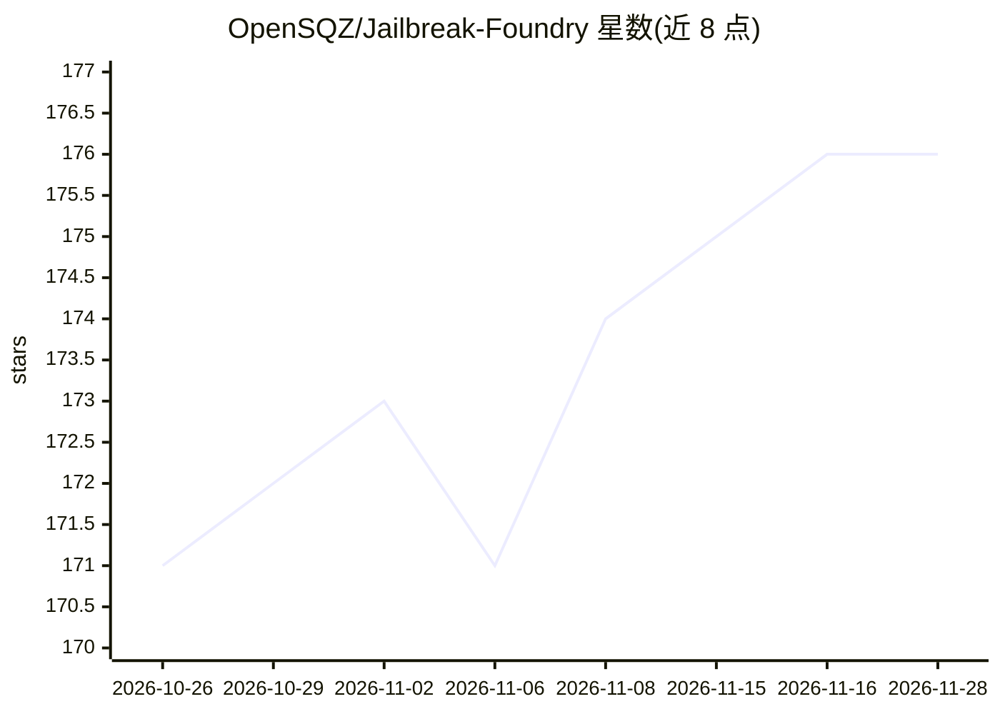

# OpenSQZ/Jailbreak-Foundry

⭐ 176 · Python · 推送 2026-11-11 · [GitHub](https://github.com/OpenSQZ/Jailbreak-Foundry) · 组织维护 · 中文 README

**把越狱研究论文转成可运行攻击模块并统一评测的系统**

面向 AI 安全研究的系统：通过 Planner/Coder/Auditor 多智能体工作流（JBF-FORGE）将越狱论文自动转译为符合 JBF-LIB 契约的可执行攻击模块，并在 JBF-EVAL 统一评测框架下以固定数据集（AdvBench/JailbreakBench/HarmBench）和 GPT-4o judge 评测，覆盖 30 种攻击与 10 个受害模型。支持从 arXiv ID 一键转译、CLI 运行攻击、断点续跑与 ASR 报告生成，配套在线 Leaderboard 与 ICML 2026 论文。

## 筛选速览

| 维度 | 判定 | 备注 |
|---|---|---|
| AI 角色 | `ai-native` | 本体是模型或模型工具 |
| 许可风险 | `none` | — |
| 部署形态 | `None` |  |
| 模型依赖 | locked-api |  |
| 硬件要求 | — | 无带数字的原话,不猜 |
| 安装摩擦 | `low` | 无编译、无系统依赖或容器化 |
| 成熟度 | — | 结构信号不足 |

## 能力要点

- 多智能体论文转译：平均 28.2 分钟将论文转为可运行攻击模块
- 统一评测协议：30 攻击 × 10 受害模型的标准化 ASR 基准
- 攻击仅需三个属性即可自动发现注册，约 58% 代码复用共享基础设施
- 支持从 arXiv ID 自动转译论文为攻击实现

## 适用场景

- 将新发表的越狱论文快速转译为可复现的攻击模块
- 在统一协议下跨模型对比攻击成功率（ASR）
- 维护随研究前沿演进的动态安全基准
- 为新攻击或防御机制贡献标准化实现

## 场景标签

`多智能体` `模型评测` `工作流自动化` `语音识别` · 领域:Agent 开发

## 证据(README 行号)

> L9: A system that translates jailbreak research papers into executable attack modules and evaluates them under a unified
> L51: - **Standardizes** evaluation across 30 attacks and 10 victim models
> L72: Multi-agent workflow automating paper-to-code conversion.

## 星数曲线

2026-10-26 171 → 2026-11-28 176（+5）

---
*卡片 v1 · prompt 1.4 · 生成 2026-11-26 · 置信度 high · 依据 README sha `653cd99e63e0` · [字段定义](../../DATASET.md)*
