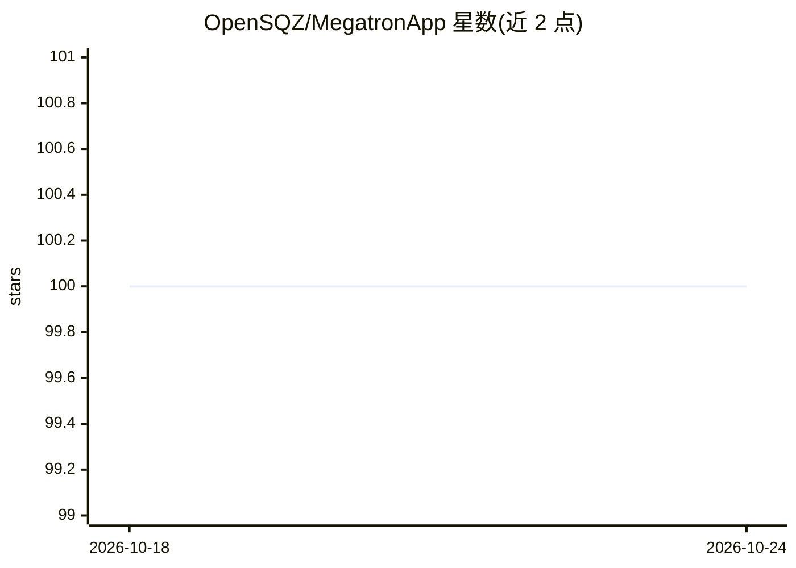

# OpenSQZ/MegatronApp

⭐ 100 · Python · NOASSERTION · 推送 2026-05-20 · [GitHub](https://github.com/OpenSQZ/MegatronApp) · 组织维护 · 中文 README

**面向 Megatron-LM 分布式训练的工具链：调优、慢节点检测、可视化**

围绕 Megatron-LM 构建的四模块插件式工具链，面向大模型分布式训练从业者：MegaScan 用 CUDA Events 低开销追踪并检测/定位 GPU 降频等硬件性能异常；MegaFBD 将前向/反向拆分到不同设备以均衡计算与显存；MegaDPP 动态优化流水线并行调度；MegaScope 实时捕获并可视化训练/推理中间结果（注意力矩阵、QKV、输出概率、PCA 投影）并支持扰动注入。模块以插件形式集成于 Megatron-LM，可通过控制开关启用。推荐通过 PyTorch NGC 容器安装，前端为 Vite+Vue+TypeScript，经 WebSocket 与后端通信。

## 筛选速览

| 维度 | 判定 | 备注 |
|---|---|---|
| AI 角色 | `ai-ecosystem` | LLM/agent 周边工具 |
| 许可风险 | `none` | NOASSERTION |
| 部署形态 | `self-host` | docker 或自建部署 |
| 模型依赖 | — | README 未给出锁定关系 |
| 硬件要求 | — | 无带数字的原话,不猜 |
| 安装摩擦 | `low` | 无编译、无系统依赖或容器化 |
| 成熟度 | — | 结构信号不足 |

## 能力要点

- MegaScan：CUDA Events 低开销追踪（测试约 10% 开销）+ 多阶段启发式异常检测与根因定位
- MegaScope：逐 token 生成的实时内部状态可视化（注意力、QKV、top-k 概率、PCA），支持三类模型扰动注入
- MegaDPP/MegaFBD：动态流水线并行调度与前后向解耦调度
- 四模块相互隔离，以插件形式集成 Megatron-LM，启动时按开关启用

## 适用场景

- 大规模分布式训练集群中定位 GPU 降频等慢节点异常
- 训练过程中实时观察模型内部状态并做可解释性分析
- 通过前后向解耦与动态流水线调度提升集群资源利用率

## 场景标签

`模型训练` `MLOps` · 领域:训练与推理

## 证据(README 行号)

> L25: MegatronApp is a toolchain built around the Megatron-LM training framework, designed to give practitioners a suite 
> L34: The four modules are fully isolated and integrated into the Megatron-LM codebase as plugins; users can flexibly ena

## 星数曲线

2026-10-18 100 → 2026-10-24 100（+0）

---
*卡片 v1 · prompt 1.4 · 生成 2026-10-23 · 置信度 high · 依据 README sha `449cbdd2203a` · [字段定义](../../DATASET.md)*
