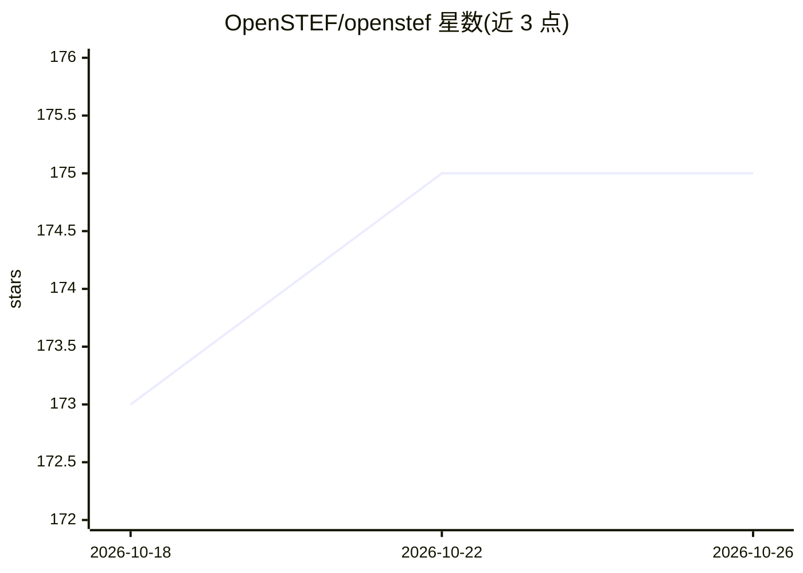

# OpenSTEF/openstef

⭐ 175 · Python · MPL-2.0 · 推送 2026-10-25 · [GitHub](https://github.com/OpenSTEF/openstef) · [官网](https://openstef.github.io/openstef) · 组织维护

**电力行业短期负荷预测的机器学习流水线 Python 框架**

OpenSTEF（Open Short-Term Energy Forecasting）是面向能源领域的模型无关 Python 框架，提供覆盖数据预处理、特征工程、模型训练、概率预测与评估的完整机器学习流水线，用于生成短期预测。4.0.0 版本重构为 monorepo，拆分为 core、models、beam（回测与评估）、meta 等子包。要求 Python ≥3.12 与 64 位系统；含 XGBoost CPU 的便捷安装，重型运行时（如 Chronos-2 基础模型）以互斥的 CPU/GPU extras 分发，GPU 需 CUDA（仅 Linux/Windows）。项目隶属 LF Energy，MPL-2.0 许可。

## 筛选速览

| 维度 | 判定 | 备注 |
|---|---|---|
| AI 角色 | `ai-native` | 本体是模型或模型工具 |
| 许可风险 | `permissive` | MPL-2.0 |
| 部署形态 | `library` | 以包/库形式分发 |
| 模型依赖 | — | README 未给出锁定关系 |
| 硬件要求 | — | 无带数字的原话,不猜 |
| 安装摩擦 | `medium` | 含编译或系统依赖之一 |
| 成熟度 | — | 结构信号不足 |

## 能力要点

- 数据预处理、特征工程、训练、概率预测、评估的完整 ML 流水线
- monorepo 拆分 core/models/beam/meta 等专用子包
- 基础模型（Chronos-2）CPU/GPU 互斥 extras 安装
- 提供 examples/ 目录的快速上手与特征工程教程

## 适用场景

- 电网短期负荷与发电量预测建模
- 能源时序数据的特征工程与模型训练
- 通过回测与评估包验证预测质量

## 场景标签

`MLOps` · 领域:训练与推理

## 证据(README 行号)

> L23: **OpenSTEF** (Open Short-Term Energy Forecasting) is an open-source, model-agnostic Python framework for creating s
> L29: OpenSTEF 4.0.0 is organized as a monorepo with specialized packages under the `packages/` directory:

## 星数曲线

2026-10-18 173 → 2026-10-26 175（+2）

---
*卡片 v1 · prompt 1.4 · 生成 2026-10-22 · 置信度 high · 依据 README sha `f61e713d71a4` · [字段定义](../../DATASET.md)*
