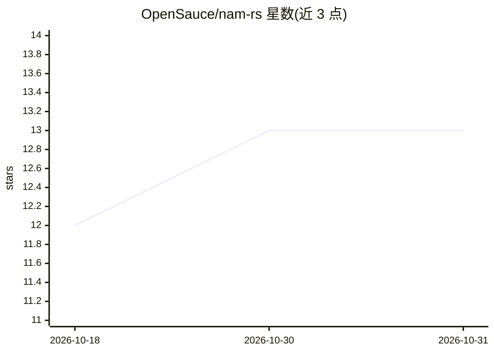

# OpenSauce/nam-rs

⭐ 13 · Rust · MIT · 推送 2026-08-24 · [GitHub](https://github.com/OpenSauce/nam-rs) · [官网](https://docs.rs/nam-rs) · 组织维护

**给音频开发者的纯 Rust 实时 NAM 模型推理库**

读取 Neural Amp Modeler 的 .nam 模型文件并执行神经网络前向计算，面向需要实时安全性的音频宿主（JACK 回调、VST3/CLAP process() 等）。音频线程零堆分配，输出与 Python/C++ 参考实现在每样本 1e-5 内一致。支持 WaveNet、LSTM、SlimmableContainer 架构。限制：不做重采样（采样率不匹配会静默出错）、只跑前向计算，DC blocker 等由宿主负责；不附带模型文件。以 cargo crate 形式提供，MSRV 为 Rust 1.71。

## 筛选速览

| 维度 | 判定 | 备注 |
|---|---|---|
| AI 角色 | `ai-native` | 本体是模型或模型工具 |
| 许可风险 | `permissive` | MIT |
| 部署形态 | `library` | 以包/库形式分发 |
| 模型依赖 | — | README 未给出锁定关系 |
| 硬件要求 | — | 无带数字的原话,不猜 |
| 安装摩擦 | `low` | 无编译、无系统依赖或容器化 |
| 成熟度 | — | 结构信号不足 |

## 能力要点

- 音频线程零堆分配的实时安全推理
- 输出与 Python/C++ 参考实现每样本误差 1e-5 内
- 支持 WaveNet（A1/A2）、LSTM、SlimmableContainer（实时宽度调节）
- 提供 loudness 与输入/输出电平校准查询 API

## 适用场景

- 在 VST3/CLAP 吉他放大器插件中加载 .nam 模型
- 在 JACK 实时回调中跑 NAM 前向计算
- 用宽度调节在 CPU 与质量间做实时权衡

## 场景标签

`推理引擎` · 领域:训练与推理

## 证据(README 行号)

> L8: Pure-Rust, real-time-safe inference for Neural Amp Modeler (NAM) `.nam` models.
> L10: Loads a `.nam` file and runs its neural-network forward pass with **no heap allocation

## 星数曲线

2026-10-18 12 → 2026-10-31 13（+1）

---
*卡片 v1 · prompt 1.4 · 生成 2026-10-31 · 置信度 high · 依据 README sha `175ac2572571` · [字段定义](../../DATASET.md)*
