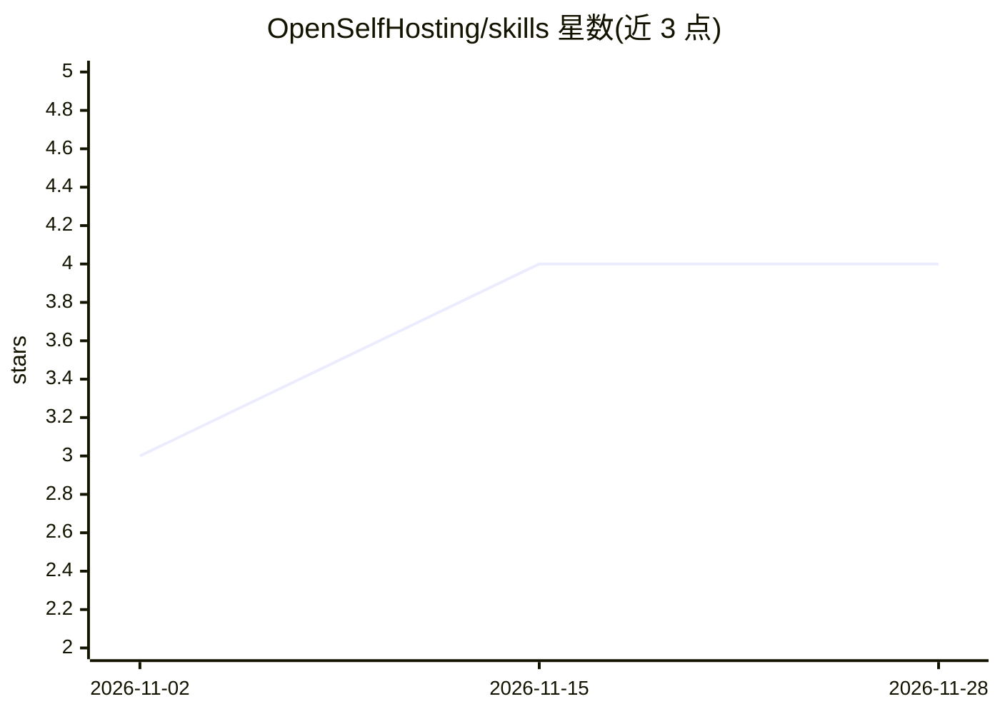

# OpenSelfHosting/skills

⭐ 4 · Python · MIT · 推送 2026-10-23 · [GitHub](https://github.com/OpenSelfHosting/skills) · 组织维护

**面向 AI 编码代理的可复用 Agent Skills 集合**

基于 Agent Skills 开放格式的社区维护集合，每个技能以独立目录和 SKILL.md 文件提供，含任务触发器、可执行工作流、验证预期与安全边界。技能目录覆盖调试、代码评审、测试、CI 故障分诊、安全审查、依赖健康、文档维护、发布评估与技能编写等 14 项；通过 skills CLI 安装，仓库内置无依赖结构校验器、自动测试与评估用例，文档以英文为主并提供阿拉伯语快速入门。

## 筛选速览

| 维度 | 判定 | 备注 |
|---|---|---|
| AI 角色 | `ai-knowledge` | 知识聚合/清单类 |
| 许可风险 | `permissive` | MIT |
| 部署形态 | `library` | 以包/库形式分发 |
| 模型依赖 | — | README 未给出锁定关系 |
| 硬件要求 | — | 无带数字的原话,不猜 |
| 安装摩擦 | `low` | 无编译、无系统依赖或容器化 |
| 成熟度 | — | 结构信号不足 |

## 能力要点

- 14 个软件开发环节的 SKILL.md 技能（调试/评审/测试/安全/CI 等）
- 通过开源 skills CLI（npx skills add）安装
- 内置无依赖结构校验器、自动化测试与评估用例
- 声明技能不授予宿主代理额外工具或权限

## 适用场景

- 让 AI 编码代理按结构化工作流做系统性调试
- 在改动前让代理快速理解陌生代码库
- 为 PR 准备与发布 go/no-go 评估提供技能支持
- 编写并测试自己的 Agent Skills

## 场景标签

`编码 Agent` `代码审查` `提示工程` · 领域:Agent 开发

## 证据(README 行号)

> L3: **Portable, practical workflows for AI agents that help people understand, change, test, secure, document, and ship 
> L5: OpenSelfHosting Skills is an open-source, community-maintained collection built on the Agent Skills open format. Eac

## 星数曲线

2026-11-02 3 → 2026-11-28 4（+1）

---
*卡片 v1 · prompt 1.4 · 生成 2026-11-21 · 置信度 high · 依据 README sha `8b38d6429fd7` · [字段定义](../../DATASET.md)*
