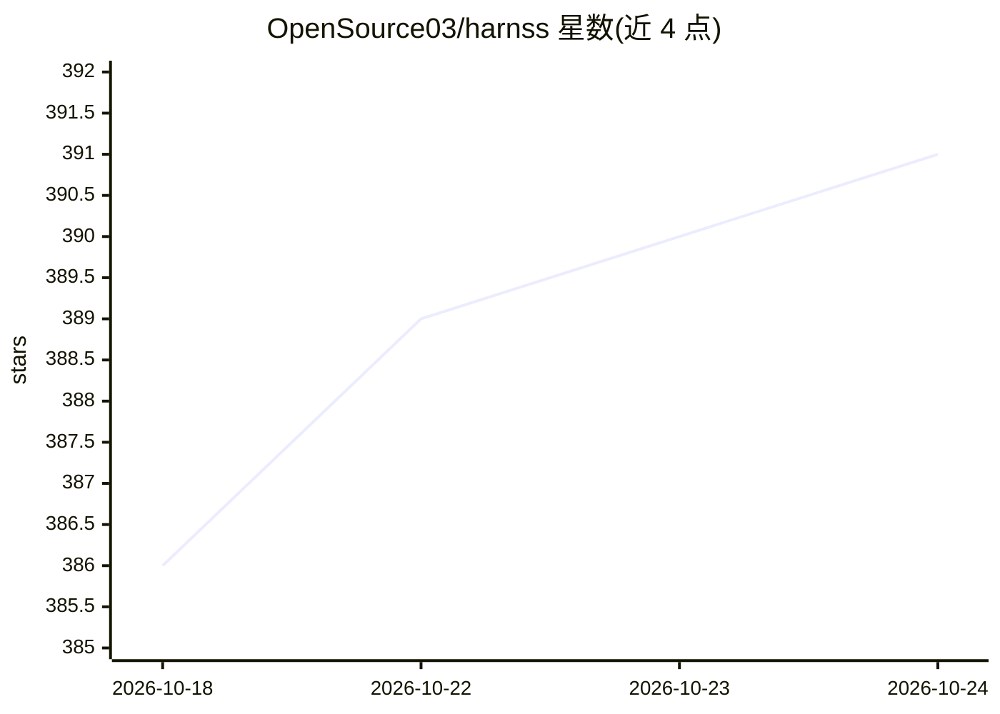

# OpenSource03/harnss

⭐ 391 · TypeScript · MIT · 推送 2026-10-21 · [GitHub](https://github.com/OpenSource03/harnss) · [官网](https://harnss.app) · 个人维护

**桌面客户端：一个界面并行运行与管理多个 AI 编程 agent**

基于 Electron 的跨平台桌面应用，通过统一界面运行、管理和切换 Claude Code、Codex 及任意兼容 Agent Client Protocol 的 agent，各会话保留独立状态与上下文。提供工具调用可视化卡片、内置终端与浏览器、git 集成、按项目配置 MCP 服务器（stdio/SSE/HTTP）、Agent Store 安装 ACP 注册表 agent、计划模式与三级权限控制、语音输入（本地 Whisper）等功能。README 声明处于早期开发且待大规模重写，预编译包未签名。

## 筛选速览

| 维度 | 判定 | 备注 |
|---|---|---|
| AI 角色 | `ai-ecosystem` | LLM/agent 周边工具 |
| 许可风险 | `permissive` | MIT |
| 部署形态 | `desktop` | 安装包/桌面程序 |
| 模型依赖 | locked-api |  |
| 硬件要求 | — | 无带数字的原话,不猜 |
| 安装摩擦 | `low` | 无编译、无系统依赖或容器化 |
| 成熟度 | `idea` | |

## 能力要点

- 并行运行 Claude Code、Codex 与 ACP 兼容 agent，切换不丢上下文
- 工具调用渲染为交互卡片（word-level diff、内联 bash 输出）
- 内置终端、浏览器、git 与按项目的 MCP 服务器管理（OAuth 自动处理）
- 从 ACP 社区注册表浏览安装 agent 的 Agent Store

## 适用场景

- 在同一个窗口里并行运行多个 AI 编程 agent 并随时切换
- 按项目接入 MCP 服务器并可视化查看工具调用
- 在应用内完成 git 提交、终端操作与浏览网页上下文

## 场景标签

`编码 Agent` · 领域:编码与开发

## 证据(README 行号)

> L18: Harnss is a cross-platform desktop app that gives you one interface to run, manage, and switch between AI coding ag
> L110: |Engine|Protocol|Requirements|
> L116: Claude Code and Codex are built-in. ACP agents can be installed from the ACP Agent Registry inside the app, or con

## 星数曲线

2026-10-18 386 → 2026-10-24 391（+5）

---
*卡片 v1 · prompt 1.4 · 生成 2026-10-21 · 置信度 mid · 依据 README sha `be775993b63f` · [字段定义](../../DATASET.md)*
