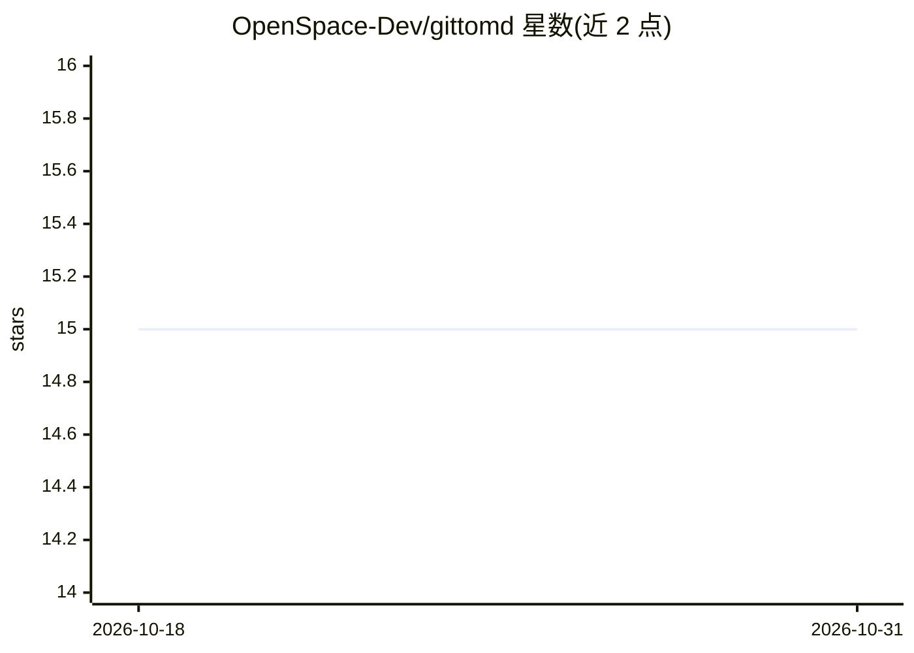

# OpenSpace-Dev/gittomd

⭐ 15 · TypeScript · 推送 2026-04-29 · [GitHub](https://github.com/OpenSpace-Dev/gittomd) · [官网](https://gittomd.com) · 组织维护

**把 GitHub 仓库打包成单个 Markdown 文件的 Web 工具**

面向需要将代码库送入 LLM、生成文档或做离线代码分析的开发者的 Web 工具：用户访问 gittomd.com 粘贴 GitHub 仓库 URL，或将仓库路径拼接进 URL，即可获得包含语言标注代码块的单个 Markdown 文件。自动忽略二进制文件与 .git、node_modules、dist 等目录，通过 Upstash Redis 缓存与 GitHub App 凭证应对 API 速率限制。基于 Next.js 15 + Tailwind CSS v4 + Octokit 构建，可本地克隆运行，需配置 GitHub App 与 Upstash Redis 环境变量。

## 筛选速览

| 维度 | 判定 | 备注 |
|---|---|---|
| AI 角色 | `ai-ecosystem` | LLM/agent 周边工具 |
| 许可风险 | `permissive` | — |
| 部署形态 | `library` | 以包/库形式分发 |
| 模型依赖 | — | README 未给出锁定关系 |
| 硬件要求 | — | 无带数字的原话,不猜 |
| 安装摩擦 | `low` | 无编译、无系统依赖或容器化 |
| 成熟度 | — | 结构信号不足 |

## 能力要点

- 输出带语言标注代码块的单文件 Markdown（LLM 友好格式）
- 自动过滤二进制文件与 .git/node_modules/dist 等目录
- 支持 URL 直连访问：gittomd.com/<user>/<repo>
- 使用 Upstash Redis 缓存与 GitHub App 凭证处理速率限制

## 适用场景

- 把整个代码库打包成 Markdown 作为 LLM 的上下文输入
- 快速生成仓库内容的离线阅读/分析材料
- 无需本地工具，通过网页粘贴仓库 URL 直接获取代码文本

## 场景标签

 · 领域:开发者工具/LLM 上下文准备

## 证据(README 行号)

> L4:  Your entire GitHub repo, intelligently packaged into a single Markdown file.
> L5:  The perfect tool for feeding codebases to LLMs, creating documentation, or for offline code analysis.

## 星数曲线

2026-10-18 15 → 2026-10-31 15（+0）

---
*卡片 v1 · prompt 1.4 · 生成 2026-10-31 · 置信度 mid · 依据 README sha `e13b5cab22e0` · [字段定义](../../DATASET.md)*
