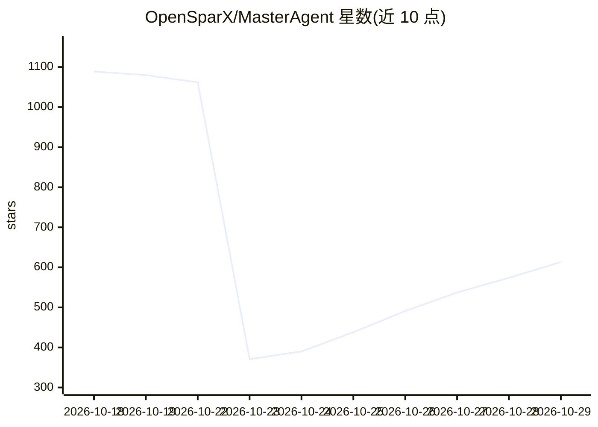

# OpenSparX/MasterAgent

⭐ 613 · C++ · Apache-2.0 · 推送 2026-09-28 · [GitHub](https://github.com/OpenSparX/MasterAgent) · [官网](https://www.opensparx.ai) · 组织维护 · 中文 README

**面向边缘设备的本地优先 C++17 agent 运行时与 SDK**

可嵌入的 C++17 同步 agent 运行时：输入先匹配确定性精确短语技能，未命中且已配置模型时经 HTTP 适配器调用本地模型服务器（/v1/chat/completions），工具名与参数须通过校验，拒绝未知工具与畸形输出。支持会话内去重、SQLite 持久化回执、UNKNOWN 故障恢复与人工对账，并提供 CLI、可重定位 CMake SDK 与库存幂等集成示例。当前为 0.4.0-alpha.3 开源参考运行时，Qualcomm QNN/Genie 集成与多步持久 DAG 未在本版本提供，评测为合成负载。

## 筛选速览

| 维度 | 判定 | 备注 |
|---|---|---|
| AI 角色 | `ai-ecosystem` | LLM/agent 周边工具 |
| 许可风险 | `permissive` | Apache-2.0 |
| 部署形态 | `None` |  |
| 模型依赖 | local-ok | 支持本地模型 |
| 硬件要求 | — | 无带数字的原话,不猜 |
| 安装摩擦 | `medium` | 含编译或系统依赖之一 |
| 成熟度 | `idea` | |

## 能力要点

- 确定性技能先于模型推理，未匹配短语返回 NO_ROUTE
- 工具名/参数校验，畸形模型输出报错而非猜测调用
- SQLite 持久回执：请求去重、UNKNOWN 恢复、证据化对账
- 上下文感知工具：幂等键、deadline、协作取消、committed/failed/unknown 结果

## 适用场景

- 在嵌入式/车载等边缘设备上集成本地 agent 执行运行时
- 需要可审计回执与故障恢复的工具调用场景
- 搭配本地 llama-server 做无云端依赖的模型调用

## 场景标签

`Agent 框架` · 领域:Agent 开发

## 证据(README 行号)

> L3: An embeddable, local-first C++17 agent runtime: turn input into validated tool
> L46: The adapter sends non-streaming `/v1/chat/completions` requests. The runtime asks
> L140: |Qualcomm QNN/Genie integration|Platform integration required; not verified by this release|

## 星数曲线

2026-10-18 1,089 → 2026-10-29 613（-476）

---
*卡片 v1 · prompt 1.4 · 生成 2026-10-21 · 置信度 high · 依据 README sha `3ab222a334a3` · [字段定义](../../DATASET.md)*
