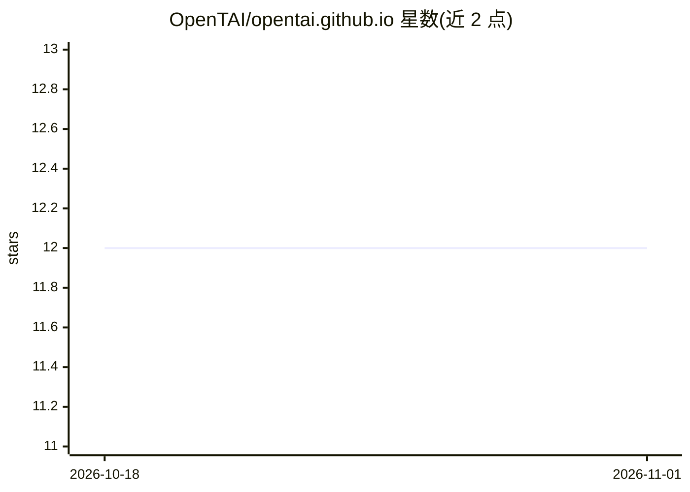

# OpenTAI/opentai.github.io

⭐ 12 · TypeScript · 推送 2026-10-26 · [GitHub](https://github.com/OpenTAI/opentai.github.io) · [官网](https://opentai.org) · 组织维护 · 中文 README

**可信 AI 开放社区官网：汇聚安全基准、数据集与论文目录**

OpenTAI（可信 AI 开放社区）的官方网站源码，静态站点经脚本从 GitHub、arXiv、Hugging Face API 抓取元数据并生成目录内容。站点收录 69 个安全基准、33 条经来源审计的数据集、772 篇论文库、公开排行榜与竞技场卡片、模型与公司目录；数据管线遵循仅收录可验证信息、不可验证字段留空标注的规则，社区投稿经 GitHub issue 审核后才进入正式数据源。提供中英双语界面，本地开发用 npm，内容管线用 Python 脚本。

## 筛选速览

| 维度 | 判定 | 备注 |
|---|---|---|
| AI 角色 | `ai-knowledge` | 知识聚合/清单类 |
| 许可风险 | `none` | — |
| 部署形态 | `None` |  |
| 模型依赖 | — | README 未给出锁定关系 |
| 硬件要求 | — | 无带数字的原话,不猜 |
| 安装摩擦 | `low` | 无编译、无系统依赖或容器化 |
| 成熟度 | — | 结构信号不足 |

## 能力要点

- 收录 69 个基准、33 条审计后数据集、772 篇论文的目录站点
- 数据管线从 GitHub/arXiv/Hugging Face API 抓取元数据自动生成
- 仅收录可验证信息，不可验证字段留空标注而非猜测填充
- 社区投稿经 GitHub issue 审核后才进入发布数据源

## 适用场景

- 查找 LLM/Agent/具身智能安全方向的基准与排行榜
- 检索安全对齐相关的数据集与论文
- 了解 AI 安全、评测与红队方向的初创公司生态

## 场景标签

`模型评测` · 领域:评测与运维

## 证据(README 行号)

> L18: |`/benchmarks`|Flagship collection, 69 entries; primary filters are LLMs, Agents, Embodied AI|
> L21: |`/datasets`|33 directly safety/trustworthiness-relevant datasets retained from a 155-record primary-source audit; 
> L22: |`/papers`|772-paper library — LLMs / Agents / Embodied AI, then Research / Survey|

## 星数曲线

2026-10-18 12 → 2026-11-01 12（+0）

---
*卡片 v1 · prompt 1.4 · 生成 2026-11-01 · 置信度 high · 依据 README sha `2803a25bbd7c` · [字段定义](../../DATASET.md)*
