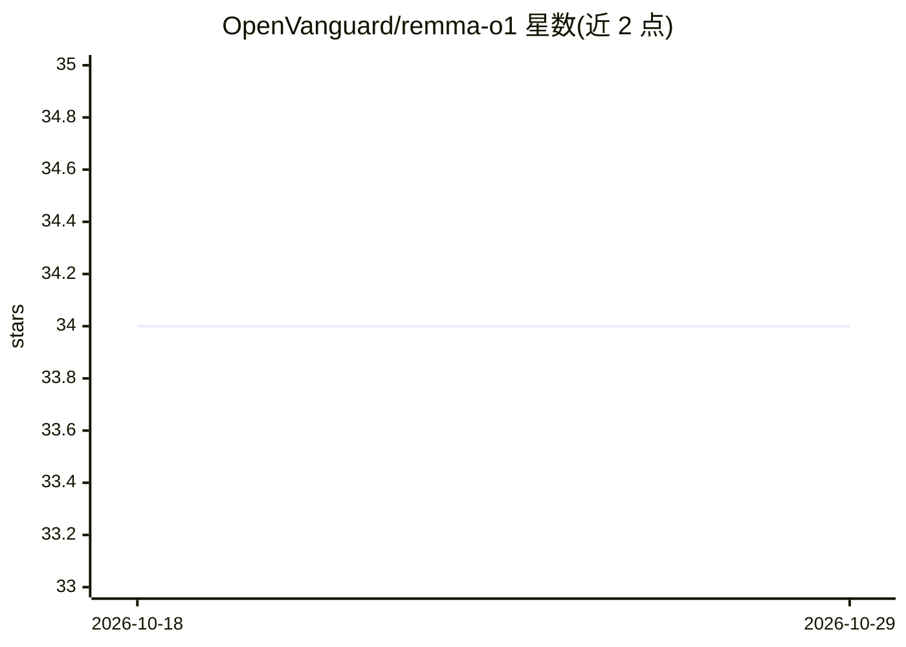

# OpenVanguard/remma-o1

⭐ 34 · Python · MIT · 推送 2026-05-25 · [GitHub](https://github.com/OpenVanguard/remma-o1) · [官网](https://remma-o1-landing-page.vercel.app/) · 组织维护

**1.17B 参数开源小语言模型（从零用 PyTorch 构建）**

OpenVanguard 发起的开源小语言模型项目，参数量 1177.79M，用 PyTorch 从零构建，目标为自然语言处理任务提供基础模型，面向开发者和研究者参与协作。使用方式为 Python 导入 Remma 类并调用 load 与 generate 生成文本。项目标注 Release Pending / Work in Progress，模型与发布尚未完成，安装通过克隆仓库并 pip 安装依赖，运行 test_remma.py 验证。

## 筛选速览

| 维度 | 判定 | 备注 |
|---|---|---|
| AI 角色 | `ai-native` | 本体是模型或模型工具 |
| 许可风险 | `permissive` | MIT |
| 部署形态 | `library` | 以包/库形式分发 |
| 模型依赖 | — | README 未给出锁定关系 |
| 硬件要求 | — | 无带数字的原话,不猜 |
| 安装摩擦 | `low` | 无编译、无系统依赖或容器化 |
| 成熟度 | `idea` | |

## 能力要点

- 参数量 1177.79M 的小语言模型
- 基于 PyTorch 从零构建，MIT 许可
- 提供 Python API：Remma.load() 后调用 generate 生成文本
- 状态为 Release Pending，明确欢迎社区协作

## 适用场景

- 研究者参与小语言模型的从零构建与改进
- 开发者在其 Python 项目中集成并生成文本
- 学习 SLM 的 PyTorch 实现结构

## 场景标签

`模型训练` · 领域:训练与推理

## 证据(README 行号)

> L9: **remma-o1** is an open-source Small Language Model (SLM) designed for collaboration, and accurate natural language 
> L50: response = model.generate("What is open source?")

## 星数曲线

2026-10-18 34 → 2026-10-29 34（+0）

---
*卡片 v1 · prompt 1.4 · 生成 2026-10-25 · 置信度 mid · 依据 README sha `7a6900c801e5` · [字段定义](../../DATASET.md)*
