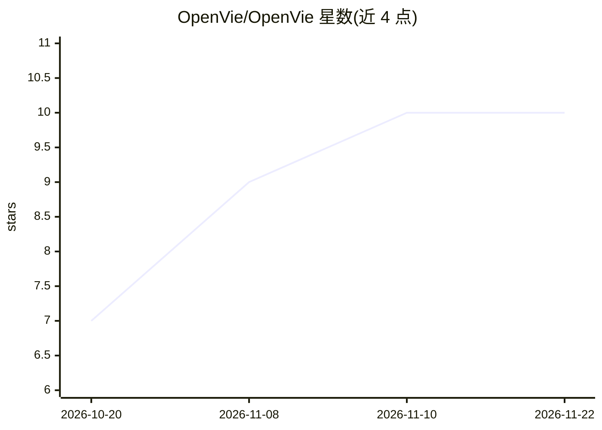

# OpenVie/OpenVie

⭐ 10 · Java · Apache-2.0 · 推送 2026-11-18 · [GitHub](https://github.com/OpenVie/OpenVie) · [官网](https://openvie.linkednodedigital.com/) · 组织维护

**越南语优先的自托管企业内部文档 RAG 平台**

面向越南语用户的开源自托管 RAG 平台，Apache-2.0 许可。架构分三部分：Spring Boot 业务 API（PostgreSQL、三级角色权限）、FastAPI 推理与检索服务、Next.js Web 客户端。文档摄取支持 PDF/DOCX/Markdown/HTML/CSV/XLSX 异步处理，检索融合 dense/sparse/graph 三路，引用仅在最终校验后展示；可选 OCR 与 ASR 默认关闭。另含 DuckDB OLAP 湖仓、离线评估回放、APISIX 边缘网关与 ClamAV 隔离。敏感路由为结构性检查，非已训练验证器。

## 筛选速览

| 维度 | 判定 | 备注 |
|---|---|---|
| AI 角色 | `ai-native` | 本体是模型或模型工具 |
| 许可风险 | `permissive` | Apache-2.0 |
| 部署形态 | `self-host` | docker 或自建部署 |
| 模型依赖 | — | README 未给出锁定关系 |
| 硬件要求 | — | 无带数字的原话,不猜 |
| 安装摩擦 | `low` | 无编译、无系统依赖或容器化 |
| 成熟度 | — | 结构信号不足 |

## 能力要点

- 混合 dense/sparse/graph 检索与引用溯源，SSE 流式输出
- PDF/DOCX/CSV 等 7 类文档异步摄取，可选 OCR 与 ASR（默认关闭）
- 组织/工作区两级三级角色权限与审计日志
- DuckDB 内嵌 OLAP 湖仓与数据血缘 DAG

## 适用场景

- 在内部服务器上基于公司文档搭建越南语问答
- 按工作区隔离不同团队的知识库与权限
- 对接入的生产 RAG 做离线标注回放评估

## 场景标签

`RAG` `文档问答` · 领域:知识与检索

## 证据(README 行号)

> L7: OpenVie là nền tảng ưu tiên tiếng Việt để tự triển khai (self-host) RAG trên tài liệu nội bộ,
> L185: |Document-grounded chat|Workspace-scoped knowledge bases, conversations, citations, hybrid dense/sparse/graph retr
> L23: |Chat trên tài liệu|Knowledge base theo workspace, hội thoại, trích dẫn, truy hồi hỗn hợp dense/sparse/graph, strea

## 星数曲线

2026-10-20 7 → 2026-11-22 10（+3）

---
*卡片 v1 · prompt 1.4 · 生成 2026-11-20 · 置信度 high · 依据 README sha `2df37f8fb136` · [字段定义](../../DATASET.md)*
