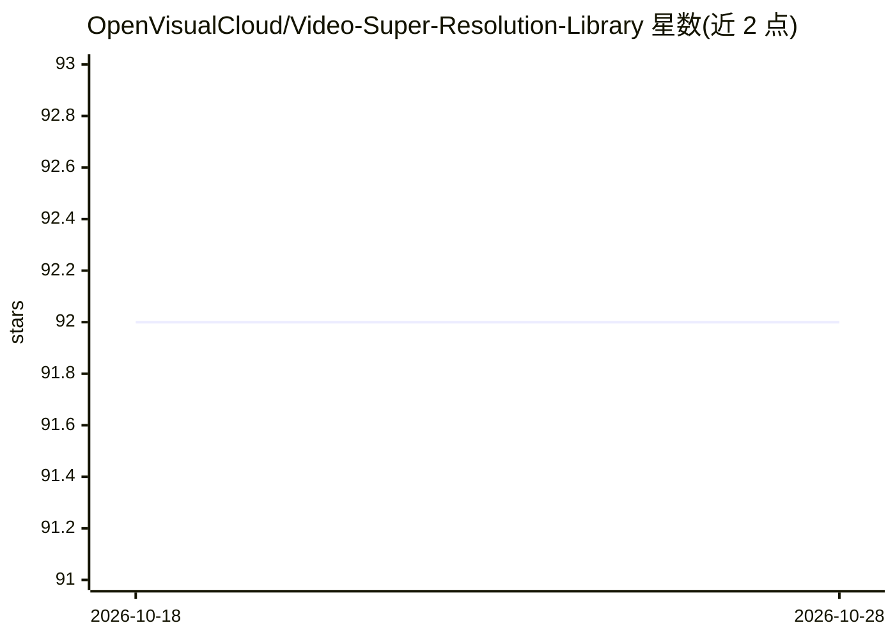

# OpenVisualCloud/Video-Super-Resolution-Library

⭐ 92 · C++ · BSD-3-Clause · 推送 2026-06-09 · [GitHub](https://github.com/OpenVisualCloud/Video-Super-Resolution-Library) · [官网](https://arxiv.org/pdf/1606.01299.pdf) · 组织维护

**Intel 的 RAISR 视频超分辨率 C/C++ 库，以 FFmpeg 插件交付**

基于公开 RAISR 算法的 C/C++ 视频超分辨率库，由 Intel 维护，实现 2x 与 1.5x 上采样，面向 Intel Xeon 平台（AVX-512/AVX-512FP16）与 Intel GPU（OpenCL）。以 Docker 容器内的 FFmpeg 滤镜插件形式提供（Docker 仅 CPU 版），通过 raisr 滤镜参数（比例、线程数、filterfolder、双 pass、mode 等）处理视频文件与图像序列，支持 x264/x265 无损编码输出及 QSV/VAAPI+OpenCL 全 GPU 管线。构建方式见 How to build.md。

## 筛选速览

| 维度 | 判定 | 备注 |
|---|---|---|
| AI 角色 | `ai-native` | 本体是模型或模型工具 |
| 许可风险 | `permissive` | BSD-3-Clause |
| 部署形态 | `None` |  |
| 模型依赖 | — | README 未给出锁定关系 |
| 硬件要求 | — | 无带数字的原话,不猜 |
| 安装摩擦 | `medium` | 含编译或系统依赖之一 |
| 成熟度 | — | 结构信号不足 |

## 能力要点

- RAISR 算法的 C/C++ 原生实现，作为 FFmpeg 滤镜插件提供
- 支持 2x/1.5x 上采样、双 pass 与 denoise 滤镜配置
- 利用 Intel AVX-512/AVX-512FP16 与 OpenCL 加速
- 可与 QSV/VAAPI 组成全 GPU 处理管线

## 适用场景

- 用 FFmpeg 命令行对视频做超分辨率上采样
- 在 Intel Xeon/GPU 上以 Docker 容器方式测试超分辨率管线
- 视频生产流程中提升低分辨率素材清晰度

## 场景标签

`图像视频处理` · 领域:感知与多模态

## 证据(README 行号)

> L9: We have enhanced the public RAISR (Rapid and Accurate Image Super Resolution), an AI based Super Resolution algorith
> L11: Enhanced RAISR is provided as an FFmpeg plugin inside of a Docker container(Docker container only for CPU) to help 

## 星数曲线

2026-10-18 92 → 2026-10-28 92（+0）

---
*卡片 v1 · prompt 1.4 · 生成 2026-10-23 · 置信度 high · 依据 README sha `a00523dff888` · [字段定义](../../DATASET.md)*
