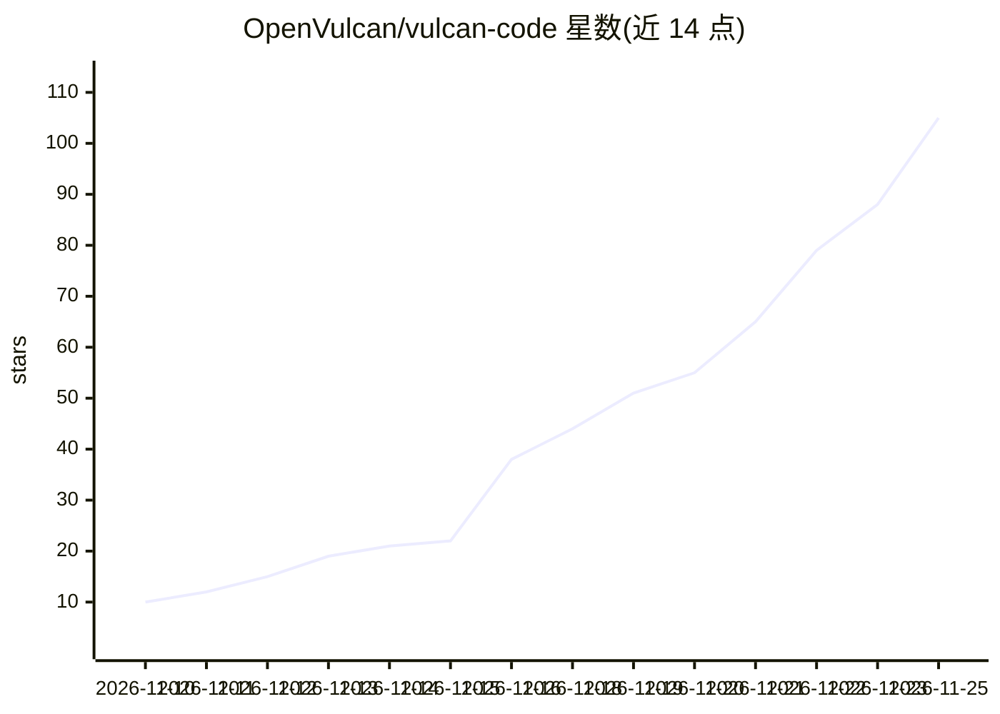

# OpenVulcan/vulcan-code

⭐ 105 · Rust · MIT · 推送 2026-11-23 · [GitHub](https://github.com/OpenVulcan/vulcan-code) · [官网](https://openvulcan.com) · 组织维护 · 中文 README

**开源 AI 编程工作台：桌面 GUI 与终端 TUI 双客户端**

Rust 编写、MIT 许可的 AI Coding 应用，含 Electron 桌面应用与 ratatui 终端 TUI，共享同一 Core 服务。功能覆盖多项目多会话、内置终端与 AI 浏览器、目标/计划模式、子代理（260+ 角色模板）、diff 审查与 Git 提交、知识库（BM25/向量/混合检索）、MemoryMesh 长期记忆、MCP 客户端与服务端、插件系统。支持 OpenAI/Anthropic/Gemini/Cohere 协议族及 DeepSeek/Kimi 等预置配置。需从源码构建，完整验证仅在 Windows x86_64。

## 筛选速览

| 维度 | 判定 | 备注 |
|---|---|---|
| AI 角色 | `ai-native` | 本体是模型或模型工具 |
| 许可风险 | `permissive` | MIT |
| 部署形态 | `None` |  |
| 模型依赖 | locked-api |  |
| 硬件要求 | — | 无带数字的原话,不猜 |
| 安装摩擦 | `low` | 无编译、无系统依赖或容器化 |
| 成熟度 | — | 结构信号不足 |

## 能力要点

- 桌面 GUI 与终端 TUI 双客户端共享同一 Core 服务
- Goal/Plan 模式与子代理（260+ 角色模板，默认关闭）
- AI 管理的知识库（BM25/向量/混合搜索）与 MemoryMesh 长期记忆
- Vulcan 自身可作为 MCP server 供 Claude Code、Codex 等调用

## 适用场景

- 在一个工作台里让 AI 理解代码、执行任务并审查结果
- 长期项目积累知识库与经验记忆供 AI 复用
- 通过 MCP 让其他 AI 工具接入 Vulcan 的项目与会话

## 场景标签

`编码 Agent` `代码审查` `Agent 记忆` `知识库管理` · 领域:Agent 开发

## 证据(README 行号)

> L19: Vulcan Code is an **AI Coding application** with two clients: a GUI desktop app and a terminal TUI. It brings proje
> L74: - Supports the OpenAI, Anthropic, Gemini and Cohere protocol families, with built-in configurations for OpenAI, Ant

## 星数曲线

2026-11-10 10 → 2026-11-25 105（+95）

---
*卡片 v1 · prompt 1.4 · 生成 2026-11-18 · 置信度 high · 依据 README sha `fc5c95272bcf` · [字段定义](../../DATASET.md)*
