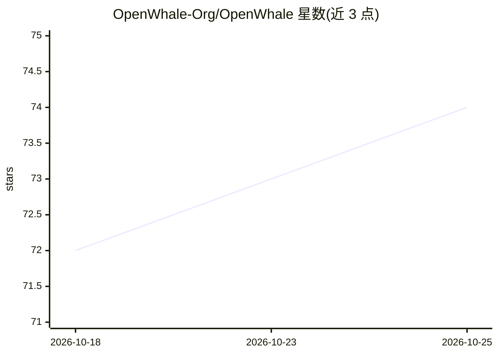

# OpenWhale-Org/OpenWhale

⭐ 74 · TypeScript · 推送 2026-10-19 · [GitHub](https://github.com/OpenWhale-Org/OpenWhale) · [官网](https://ow.gm.town) · 组织维护 · 中文 README

**TypeScript 自动化交易策略框架，AI 可编写/驱动策略**

面向加密货币与链上交易策略开发者的 TypeScript 框架，采用 Monitor→Strategy→Executor 三层解耦架构，策略与交易所通过（kind×venue）适配矩阵绑定，内置 ccxt 数据驱动的 12 个交易所名单。提供 Next.js 仪表盘、网关服务、插件安装机制、运行追踪与 PnL 归因。AI 相关能力包括策略内结构化输出 LLM 推理、自然语言策略编译器（实验性）以及教 Claude 编写插件的 skill。以 git clone + pnpm 或 Docker Compose 方式部署。

## 筛选速览

| 维度 | 判定 | 备注 |
|---|---|---|
| AI 角色 | `ai-enhanced` | 去掉 AI 部分产品仍成立 |
| 许可风险 | `none` | — |
| 部署形态 | `self-host` | docker 或自建部署 |
| 模型依赖 | — | README 未给出锁定关系 |
| 硬件要求 | — | 无带数字的原话,不猜 |
| 安装摩擦 | `low` | 无编译、无系统依赖或容器化 |
| 成熟度 | `idea` | |

## 能力要点

- Monitor/Strategy/Executor 三层解耦，策略可跨交易所与数据源运行
- 策略内结构化输出 LLM 推理与实验性自然语言策略编译器
- （kind×venue）适配矩阵，ccxt 名单内置 12 个交易所
- 运行追踪持久化与按实例的 PnL 归因（含手续费/资金费拆分）

## 适用场景

- 编写并运行资金费率、跨所套利、做市等自动化交易策略
- 通过仪表盘管理策略实例、账户与盈亏归因
- 让 Claude 借助 openwhale-dev skill 生成完整策略插件
- 镜像目标账户或钱包进行跟单交易

## 场景标签

`金融量化` `代码生成` · 领域:编码与开发

## 证据(README 行号)

> L11: OpenWhale is a TypeScript framework for automated trading strategies. Monitors collect, Strategies decide, Executor
> L89: - **AI as a programmer** — structured-output LLM inference inside strategies, and a `skills/openwhale-dev` skill th
> L121: |**Compiler / Assistant**|Natural-language strategy compiler (experimental). Recommended path: Claude with `skills

## 星数曲线

2026-10-18 72 → 2026-10-25 74（+2）

---
*卡片 v1 · prompt 1.4 · 生成 2026-10-24 · 置信度 mid · 依据 README sha `8fbeedd64764` · [字段定义](../../DATASET.md)*
