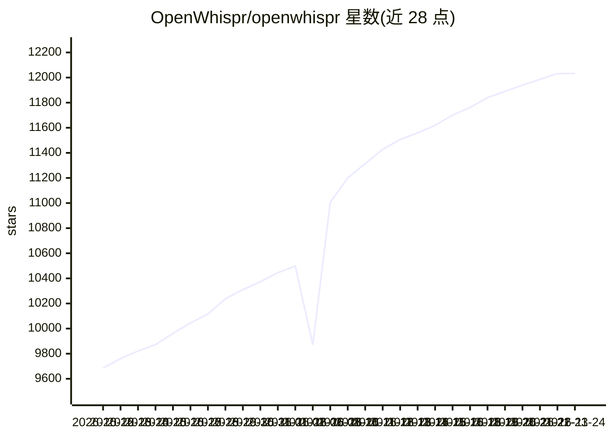

# OpenWhispr/openwhispr

⭐ 12,116 · JavaScript · MIT · 推送 2026-11-24 · [GitHub](https://github.com/OpenWhispr/openwhispr) · [官网](https://openwhispr.com) · 组织维护

**隐私优先的桌面语音转文字应用，支持本地与云端模型**

开源跨平台（macOS/Windows/Linux）的语音输入工具：按全局热键说话，文字粘贴到光标处；本地模型（Whisper、Parakeet、Cohere、Orukeet）实现离线转写，音频不出设备，也可用自带 API key 走云端。功能含会议转写与说话人分离、笔记与语义搜索、团队空间、音频文件导入转写、公共 API 与 MCP 服务器。MIT 许可，本地功能免费无字数限制，官方云服务有免费额度与付费档。桌面端提供安装包，源码需 Node.js 24+。

## 筛选速览

| 维度 | 判定 | 备注 |
|---|---|---|
| AI 角色 | `ai-native` | 本体是模型或模型工具 |
| 许可风险 | `permissive` | MIT |
| 部署形态 | `desktop` | 安装包/桌面程序 |
| 模型依赖 | — | README 未给出锁定关系 |
| 硬件要求 | — | 无带数字的原话,不猜 |
| 安装摩擦 | `medium` | 含编译或系统依赖之一 |
| 成熟度 | — | 结构信号不足 |

## 能力要点

- 本地语音转写（Whisper/Parakeet/Cohere/Orukeet），音频不离开设备
- 会议自动检测、说话人分离与语音指纹识别
- 语音 AI 助手（GPT-5/Claude/Gemini/Groq/OpenRouter/本地模型）
- 本地模型支持 Metal、CUDA、Vulkan GPU 加速

## 适用场景

- 在任意应用中用热键语音输入并自动粘贴
- 离线转写会议记录并区分说话人
- 把已有音视频文件或 YouTube 链接批量转写为文字
- 通过公共 API 或 MCP 管理笔记与转写内容

## 场景标签

`语音识别` · 领域:感知与多模态

## 证据(README 行号)

> L12:  Privacy-first voice-to-text dictation with AI agents, meeting transcription, and notes. Cross-platform for macOS, 
> L20: OpenWhispr turns your voice into text, notes, and actions from your desktop. Press a hotkey, speak, and your words 

## 星数曲线

2026-10-22 9,685 → 2026-11-24 12,032（+2,347）

---
*卡片 v1 · prompt 1.4 · 生成 2026-11-22 · 置信度 high · 依据 README sha `b1bd2eb67eb2` · [字段定义](../../DATASET.md)*
