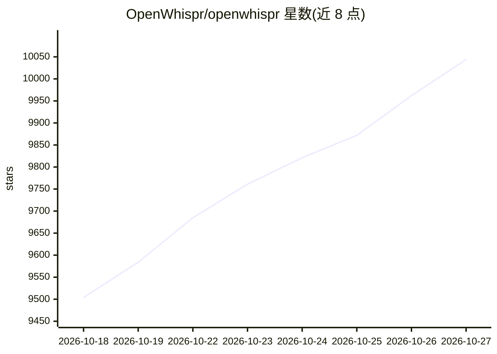

# OpenWhispr/openwhispr

⭐ 10,044 · JavaScript · MIT · 推送 2026-10-26 · [GitHub](https://github.com/OpenWhispr/openwhispr) · [官网](https://openwhispr.com) · 组织维护

**跨平台语音听写桌面应用：本地/云端转文字与笔记**

面向桌面用户的开源语音转文字听写应用，支持 macOS/Windows/Linux。按全局热键说话即可在任意应用中粘贴文字，提供听写翻译、AI 语音助手、会议转录（说话人分离与声纹识别）、笔记与语义搜索、音频/视频导入转写等功能。可选择本地模型（Whisper、NVIDIA Parakeet，经 Metal/CUDA/Vulkan 加速，音频不出设备）或 BYOK 云端处理；企业功能含 SSO/SCIM 与集中管理 Bedrock/Azure OpenAI 访问。Electron 应用，提供安装包与源码运行两种途径；Intel Mac 不支持实时说话人识别。

## 筛选速览

| 维度 | 判定 | 备注 |
|---|---|---|
| AI 角色 | `ai-native` | 本体是模型或模型工具 |
| 许可风险 | `permissive` | MIT |
| 部署形态 | `desktop` | 安装包/桌面程序 |
| 模型依赖 | — | README 未给出锁定关系 |
| 硬件要求 | — | 无带数字的原话,不猜 |
| 安装摩擦 | `medium` | 含编译或系统依赖之一 |
| 成熟度 | — | 结构信号不足 |

## 能力要点

- 本地离线转录（Whisper/Parakeet，Metal/CUDA/Vulkan 加速），无遥测无数据收集
- 会议自动检测（Zoom/Teams/FaceTime）与设备端说话人分离/声纹识别
- AI 语音助手可接入 GPT-5、Claude、Gemini、Groq、OpenRouter 或本地模型
- 提供公共 API 与 MCP server，可编程管理笔记与转写

## 适用场景

- 在任意应用中按热键语音听写并自动粘贴
- 本地离线转录会议并区分说话人
- 用语音向 AI 助手下指令并就地编辑选中文本
- 导入音频/视频文件或 YouTube 链接批量转写

## 场景标签

`语音识别` `AI 助手` `知识库管理` `语义搜索` · 领域:对话与助手

## 证据(README 行号)

> L20: OpenWhispr turns your voice into text, notes, and actions from your desktop. Press a hotkey, speak, and your words 
> L41: - **Voice dictation** — global hotkey to dictate into any app with automatic pasting

## 星数曲线

2026-10-18 9,504 → 2026-10-27 10,044（+540）

---
*卡片 v1 · prompt 1.4 · 生成 2026-10-20 · 置信度 mid · 依据 README sha `72ed0d06550a` · [字段定义](../../DATASET.md)*
