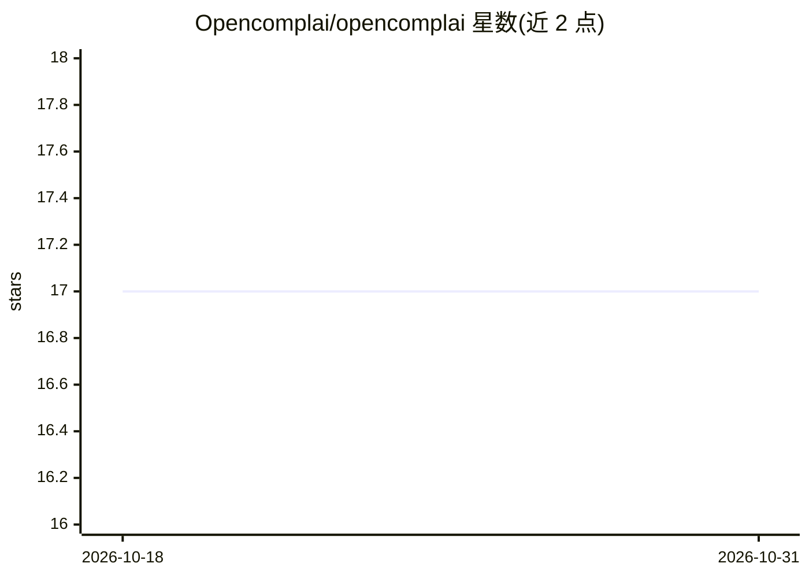

# Opencomplai/opencomplai

⭐ 17 · Python · AGPL-3.0 · 推送 2026-10-29 · [GitHub](https://github.com/Opencomplai/opencomplai) · [官网](https://opencomplai.com/) · 组织维护

**面向 CI/CD 的 EU AI Act 合规自动化规则引擎**

将欧盟 AI Act 合规检查嵌入 CI/CD 管道的合规即代码工具：以清单定义系统信息，通过确定性规则引擎评估风险并输出 Pass/Fail 门禁；EU AI Act 原生评估，NIST AI RMF 由同一证据经内置 crosswalk 派生，ISO 42001 为本征包，DORA/EBA 仅映射。附带 CLI、Python SDK、可选 Docker Compose 服务部署，以及生成 Annex IV 文档的持久控制台账。面向构建、微调或大幅修改 AI 系统且需逐版本合规检查的团队，核心引擎无 LLM/ML 推理。

## 筛选速览

| 维度 | 判定 | 备注 |
|---|---|---|
| AI 角色 | `ai-ecosystem` | LLM/agent 周边工具 |
| 许可风险 | `dual` | AGPL-3.0 |
| 部署形态 | `self-host` | docker 或自建部署 |
| 模型依赖 | local-ok | 支持本地模型 |
| 硬件要求 | — | 无带数字的原话,不猜 |
| 安装摩擦 | `low` | 无编译、无系统依赖或容器化 |
| 成熟度 | `idea` | |

## 能力要点

- 确定性规则引擎，核心无 LLM/ML 推理
- EU AI Act 原生评估，NIST AI RMF/ISO 42001/DORA/EBA 以派生或映射方式覆盖
- pip 单命令安装 CLI+规则引擎+SDK
- 生成不超出实际证据范围的 Annex IV 文档与控制台账

## 适用场景

- 在 CI 中为 AI 系统版本发布做 EU AI Act 门禁检查
- 对照 EU AI Act 与 NIST AI RMF 并行评估
- 生成并维护带证据哈希的合规工件与 Annex IV 文档

## 场景标签

 · 领域:AI 治理/合规工具

## 证据(README 行号)

> L5: OpenComplAI brings AI compliance directly into your CI/CD pipeline, turning fragmented legal mandates into automated
> L30: Teams that build, fine-tune or substantially modify AI systems and need a per-release EU AI Act check in CI.
> L162: The core rule engine (`packages/core`) and CLI are fully deterministic and rule-based — no

## 星数曲线

2026-10-18 17 → 2026-10-31 17（+0）

---
*卡片 v1 · prompt 1.4 · 生成 2026-10-30 · 置信度 mid · 依据 README sha `862fa2e69366` · [字段定义](../../DATASET.md)*
