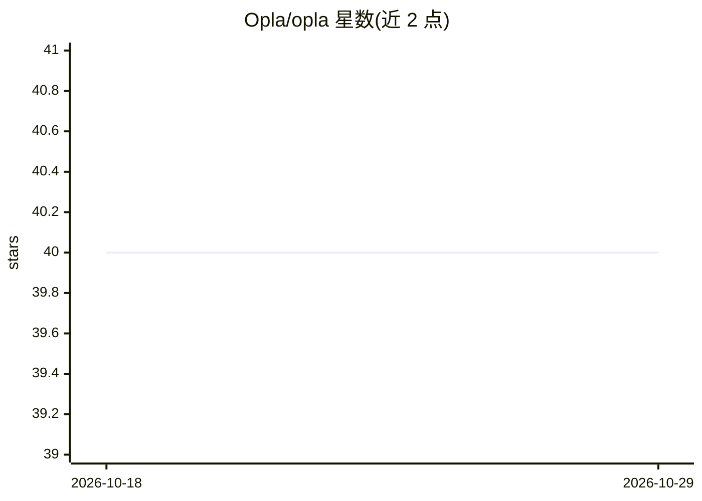

# Opla/opla

⭐ 40 · TypeScript · Apache-2.0 · 推送 2026-10-16 · [GitHub](https://github.com/Opla/opla) · [官网](https://opla.ai) · 组织维护

**本地运行开源大模型的桌面 AI 助手应用**

Opla 是一款在用户设备本地运行开源生成式 AI（Llama3、Mistral、Gemma 等 LLM）的桌面应用，定位为个人生产力助手：离线运行、数据留在本机、自动化日常任务。产品处于活跃开发早期，官方在 README 中自述可能存在未完成功能。用户可从 Opla.ai 下载 Windows/Linux/macOS 安装包，开发者可经 Rust+Node.js 环境、git clone 与 tauri dev 从源码构建运行。采用 Apache 2.0 许可证开源。

## 筛选速览

| 维度 | 判定 | 备注 |
|---|---|---|
| AI 角色 | `ai-native` | 本体是模型或模型工具 |
| 许可风险 | `permissive` | Apache-2.0 |
| 部署形态 | `library` | 以包/库形式分发 |
| 模型依赖 | — | README 未给出锁定关系 |
| 硬件要求 | — | 无带数字的原话,不猜 |
| 安装摩擦 | `low` | 无编译、无系统依赖或容器化 |
| 成熟度 | `idea` | |

## 能力要点

- 本地离线运行 Llama3、Mistral、Gemma 等开源 LLM
- 数据保存在用户本机设备上
- 提供 Windows、Linux、macOS（Intel/Mx）安装包下载

## 适用场景

- 在无网络或注重隐私的环境下使用本地 AI 助手
- 用本地 LLM 自动化处理日常任务
- 不想把数据发送到云端时在桌面端运行开源模型

## 场景标签

`AI 助手` · 领域:对话与助手

## 证据(README 行号)

> L5: ## Empower Your Productivity with Local AI Assistants
> L6: Experience the power of Opla, harnessing your device's capabilities to run cutting-edge, open-source generative AI. 
> L15: Opla isn't just another AI tool. It's your personal productivity booster, designed to work offline, ensuring your d

## 星数曲线

2026-10-18 40 → 2026-10-29 40（+0）

---
*卡片 v1 · prompt 1.4 · 生成 2026-10-25 · 置信度 mid · 依据 README sha `0182994ebb77` · [字段定义](../../DATASET.md)*
