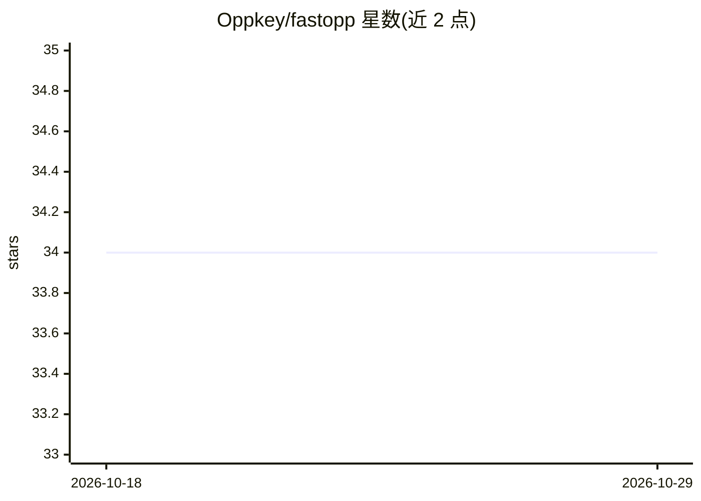

# Oppkey/fastopp

⭐ 34 · Python · MIT · 推送 2025-12-02 · [GitHub](https://github.com/Oppkey/fastopp) · [官网](https://fastopp-site.fly.dev/) · 组织维护

**面向学生的 FastAPI AI Web 应用脚手架，带 Django 式后台**

基于 FastAPI 的观点鲜明的启动框架，供学生和新手开发者构建 AI Web 应用：提供类 Django 的管理后台（基于角色的认证）、SQLModel 数据库与迁移、Django 风格 HTML 模板、自动生成 API 文档，以及 oppman.py/oppdemo.py 管理工具；AI 功能通过 OpenRouter API 接入云端 LLM（默认 meta-llama/llama-3.3-70b-instruct:free）。自述不适用于生产环境或有经验的开发者，安全架构自评仅供学习，安装需 Python 3.12 与 uv。

## 筛选速览

| 维度 | 判定 | 备注 |
|---|---|---|
| AI 角色 | `ai-ecosystem` | LLM/agent 周边工具 |
| 许可风险 | `permissive` | MIT |
| 部署形态 | `library` | 以包/库形式分发 |
| 模型依赖 | locked-api |  |
| 硬件要求 | — | 无带数字的原话,不猜 |
| 安装摩擦 | `low` | 无编译、无系统依赖或容器化 |
| 成熟度 | — | 结构信号不足 |

## 能力要点

- 类 Django 管理后台与角色认证、SQL 数据库迁移
- 通过 OpenRouter API 接入 LLM 的 AI Chat 功能
- oppman.py 数据库/用户管理工具与 oppdemo.py 演示数据工具
- 基于 Tailwind CSS、DaisyUI、AlpineJS、HTMX 的可选 UI 设计系统

## 适用场景

- 学生快速搭建可写进简历的 AI Web 应用原型
- 从 Streamlit/Gradio 迁移到结构更清晰的后端
- 不熟悉 JavaScript 的 Python 开发者做 AI 应用原型

## 场景标签

 · 领域:Web 开发框架/AI 应用脚手架

## 证据(README 行号)

> L56: FastAPI starter package for students prototyping AI web applications. Pre-built admin
> L75: FastOpp provides an opinionated framework for FastAPI with the following features:

## 星数曲线

2026-10-18 34 → 2026-10-29 34（+0）

---
*卡片 v1 · prompt 1.4 · 生成 2026-10-25 · 置信度 high · 依据 README sha `90208353d74e` · [字段定义](../../DATASET.md)*
