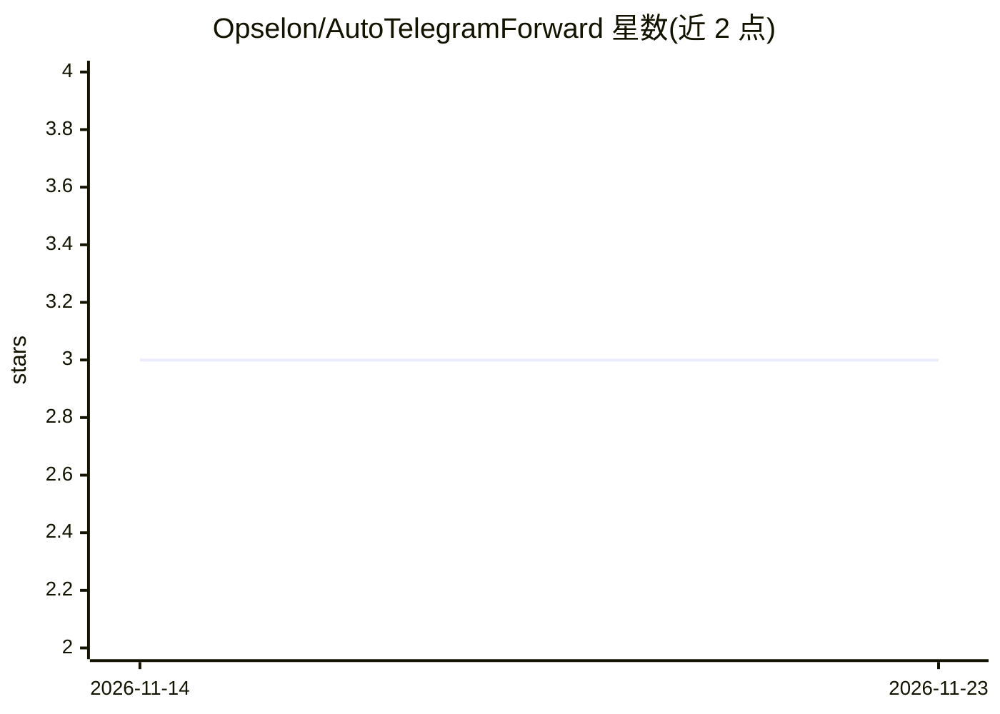

# Opselon/AutoTelegramForward

⭐ 3 · Python · 推送 2026-11-07 · [GitHub](https://github.com/Opselon/AutoTelegramForward) · [官网](https://opselon.github.io/AutoTelegramForward/) · 个人维护

**Telegram 频道自动转发与路由套件，带 AI 改写与多端管理界面**

基于 MTProto 的 Telegram 消息自动转发套件，由四个微服务组成：Python 核心引擎（MTProto 客户端池、规则管线、AI 改写）、Go REST 控制平面、Rust Axum 网关与 React 仪表盘、Rust 日志引擎，另有 Flutter 移动端与统一进程管理 CLI（atf）。功能含链接/@提及重写、品牌中转、内容清理、SHA-256 去重、回复同步、多租户隔离与 10 种语言的机器人界面。AI 改写部分支持提示词库管理与对接外部 AI 提供方。

## 筛选速览

| 维度 | 判定 | 备注 |
|---|---|---|
| AI 角色 | `ai-enhanced` | 去掉 AI 部分产品仍成立 |
| 许可风险 | `permissive` | — |
| 部署形态 | `desktop` | 安装包/桌面程序 |
| 模型依赖 | — | README 未给出锁定关系 |
| 硬件要求 | — | 无带数字的原话,不猜 |
| 安装摩擦 | `low` | 无编译、无系统依赖或容器化 |
| 成熟度 | — | 结构信号不足 |

## 能力要点

- 四微服务架构：Python MTProto 核心 + Go API + Rust 网关/日志引擎
- 链接替换、@提及重写与品牌中转（A→C→B）路由
- SHA-256 消息与相册指纹去重，回复/编辑同步
- 支持 10 种语言的机器人 UI 与多租户隔离

## 适用场景

- 把源频道消息按规则自动转发到目标频道
- 转发时清理链接、话题标签并替换链接与 @提及
- 通过品牌中转让目标频道显示自定义频道头
- 自托管多用户转发服务并隔离各租户规则与会话

## 场景标签

 · 领域:社交通信/自动化工具

## 证据(README 行号)

> L151:  - Domain-Driven Design (DDD) rule evaluation pipeline, content sanitization, deduplication, and AI transformation
> L176:  The global prompt manager (`AI → 🧠 Prompts`) closes the bot's missing surface: list, create, rename, edit the sys
> L188: - 🌐 **10-Language 1:1 Parity**:

## 星数曲线

2026-11-14 3 → 2026-11-23 3（+0）

---
*卡片 v1 · prompt 1.4 · 生成 2026-11-22 · 置信度 mid · 依据 README sha `e66243c3f5be` · [字段定义](../../DATASET.md)*
