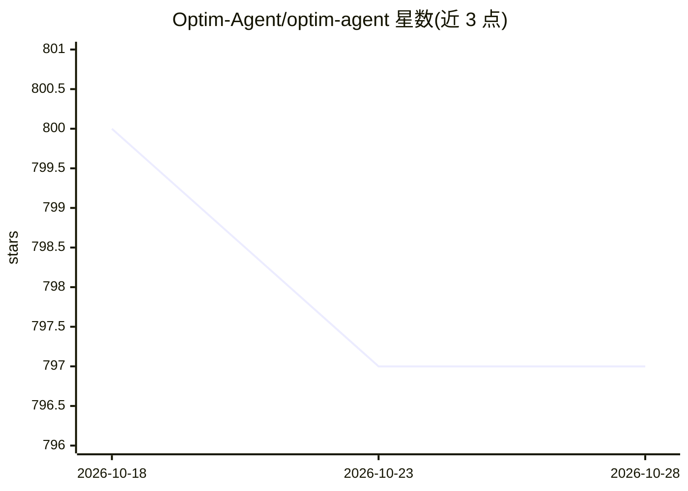

# Optim-Agent/optim-agent

⭐ 797 · Python · MIT · 推送 2026-08-14 · [GitHub](https://github.com/Optim-Agent/optim-agent) · [官网](https://optim-agent.github.io/optim-agent/) · 组织维护 · 中文 README

**让 Claude Code/Codex 等 coding agent 充当超参数优化器的 Python 库**

面向算法工程师的参数调优库：通过已认证的 agent CLI（claude/codex/opencode）读取代码与参数语义，结合试验历史提出下一组配置，对声明的参数空间校验后记录目标值，agent 回复无效时回退安全采样。适用场景覆盖模型训练、推理服务、量化研究、强化学习与科学工作流。研究记录以 JSON/SQLite 保存可审计；README 含 Branin/Ackley、MNIST/CIFAR-10、Gymnasium RL、UCI 信用违约等基准及与 Random/TPE/GP-BO 的对比数据。以 PyPI 包、Claude Code 插件与 Codex skill 三种形式安装，需 PATH 上有 agent CLI。

## 筛选速览

| 维度 | 判定 | 备注 |
|---|---|---|
| AI 角色 | `ai-ecosystem` | LLM/agent 周边工具 |
| 许可风险 | `permissive` | MIT |
| 部署形态 | `library` | 以包/库形式分发 |
| 模型依赖 | locked-api |  |
| 硬件要求 | — | 无带数字的原话,不猜 |
| 安装摩擦 | `low` | 无编译、无系统依赖或容器化 |
| 成熟度 | — | 结构信号不足 |

## 能力要点

- AgentSampler 结合参数语义与试验历史提出配置，校验后记录结果
- agent 回复无效时回退安全采样，执行有界
- JSON/SQLite 研究记录保留配置、结果与可选 agent 理由
- 提供 PyPI 包、Claude Code 插件、Codex skill 三种安装形式

## 适用场景

- 调优模型训练超参（学习率、架构、正则化等）
- 调优推理服务的量化、批处理、路由参数以平衡质量与延迟
- 小评估预算下替代经典代理模型做黑盒参数搜索
- 复盘调优过程：查看每次试验的配置、结果与 agent 决策理由

## 场景标签

`模型训练` · 领域:训练与推理

## 证据(README 行号)

> L27: optim-agent lets Claude Code / Codex / OpenCode tune real system parameters by
> L82: Requires one authenticated agent CLI on `PATH`:

## 星数曲线

2026-10-18 800 → 2026-10-28 797（-3）

---
*卡片 v1 · prompt 1.4 · 生成 2026-10-21 · 置信度 high · 依据 README sha `eb8db165ead1` · [字段定义](../../DATASET.md)*
