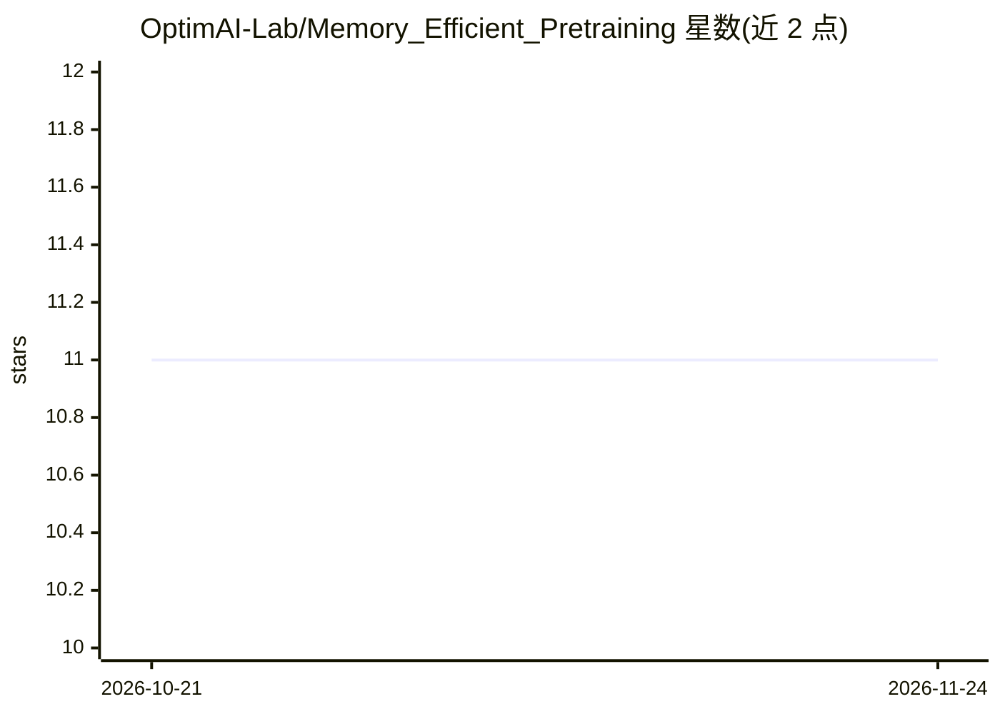

# OptimAI-Lab/Memory_Efficient_Pretraining

⭐ 11 · Python · 推送 2026-07-02 · [GitHub](https://github.com/OptimAI-Lab/Memory_Efficient_Pretraining) · 组织维护

**LLM 参数/内存高效预训练算法的实验框架与论文代码**

论文 Scalable Parameter and Memory Efficient Pretraining for LLM 的配套代码库，实现 11 种参数与内存高效的预训练方法（Adam、GaLore、Apollo、FIRA、ReLoRA、SPAM 等），提供统一框架用于对比不同优化算法。支持 Llama 与 Qwen2 两种架构，配置文件覆盖 9M 至 13B 参数规模，通过 torchrun 进行分布式训练。安装需 pip 安装依赖并以可编辑模式安装本地包，提供示例训练脚本作为模板。

## 筛选速览

| 维度 | 判定 | 备注 |
|---|---|---|
| AI 角色 | `ai-ecosystem` | LLM/agent 周边工具 |
| 许可风险 | `none` | — |
| 部署形态 | `library` | 以包/库形式分发 |
| 模型依赖 | — | README 未给出锁定关系 |
| 硬件要求 | — | 无带数字的原话,不猜 |
| 安装摩擦 | `low` | 无编译、无系统依赖或容器化 |
| 成熟度 | — | 结构信号不足 |

## 能力要点

- 实现 11 种参数/内存高效预训练算法的统一实验框架
- 支持 Llama 与 Qwen2 架构，配置覆盖 9M 到 13B 参数规模
- 提供 torchrun 分布式训练入口（DDP）与示例脚本模板

## 适用场景

- 在自己的模型规模和配置上复现论文中的高效预训练方法
- 对比不同低秩/内存高效优化算法的训练效果
- 以示例脚本为模板搭建自定义预训练实验

## 场景标签

`模型训练` · 领域:训练与推理

## 证据(README 行号)

> L7: This repository contains the code accompanying our paper Scalable Parameter and Memory Efficient Pretraining for LLM
> L37: - **torchrun_main_DDP.py**: Main entry point for distributed training
> L41: This repository implements the following training methods:

## 星数曲线

2026-10-21 11 → 2026-11-24 11（+0）

---
*卡片 v1 · prompt 1.4 · 生成 2026-11-19 · 置信度 mid · 依据 README sha `1d57b38caa4e` · [字段定义](../../DATASET.md)*
