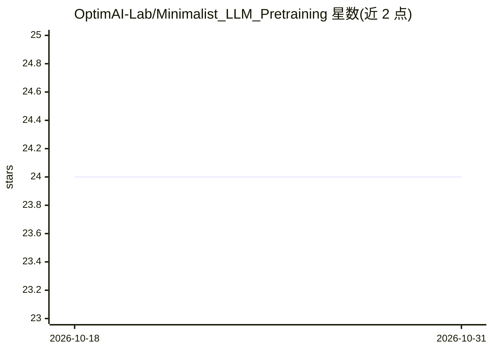

# OptimAI-Lab/Minimalist_LLM_Pretraining

⭐ 24 · Python · 推送 2026-05-26 · [GitHub](https://github.com/OptimAI-Lab/Minimalist_LLM_Pretraining) · 组织维护

**论文配套代码：SCALE 低显存 LLM 预训练优化器**

ICML 2026 论文 "Memory-Efficient LLM Pretraining via Minimalist Optimizer Design" 的初步代码发布。实现 SCALE 优化器：由梯度的逐列归一化与仅限最后层的一阶动量两个组件构成，用于降低预训练时模型+优化器的内存占用。仓库提供 LLaMA 60M–7B 在 C4 数据集上以困惑度为指标的数值结果表，以及实验所用脚本，位于 scripts/ 目录，通过 torchrun 以 DDP 方式启动。优化器实现位于 mem_eff_pt/pt_scale/scale_optimizer.py。

## 筛选速览

| 维度 | 判定 | 备注 |
|---|---|---|
| AI 角色 | `ai-ecosystem` | LLM/agent 周边工具 |
| 许可风险 | `none` | — |
| 部署形态 | `None` |  |
| 模型依赖 | — | README 未给出锁定关系 |
| 硬件要求 | — | 无带数字的原话,不猜 |
| 安装摩擦 | `low` | 无编译、无系统依赖或容器化 |
| 成熟度 | `idea` | |

## 能力要点

- SCALE 优化器：逐列梯度归一化 + 仅最后层一阶动量
- 提供 LLaMA 60M–1B 与 7B 在 C4 上的预训练实验脚本
- 对比表涵盖 Adam/Muon/GaLore/Fira/SWAN/APOLLO/Stable-SPAM 等方法
- 以 torchrun 多卡 DDP 方式运行训练入口脚本

## 适用场景

- 复现论文中 SCALE 优化器的 LLaMA 预训练实验
- 在显存受限环境下进行 LLM 预训练
- 在自有预训练流程中替换/接入 SCALE 优化器实现

## 场景标签

`模型训练` · 领域:训练与推理

## 证据(README 行号)

> L7: Preliminary code release for our paper "Memory-Efficient LLM Pretraining via Minimalist Optimizer Design", by Athana
> L11: We introduce our proposed optimizer, SCALE, detailed in Algorithm 1. The design of SCALE is motivated by empirical 
> L54: The SCALE optimizer code can be found in `mem_eff_pt/pt_scale/scale_optimizer.py`. The repository provides the scri

## 星数曲线

2026-10-18 24 → 2026-10-31 24（+0）

---
*卡片 v1 · prompt 1.4 · 生成 2026-10-27 · 置信度 high · 依据 README sha `b4fc13d2140e` · [字段定义](../../DATASET.md)*
