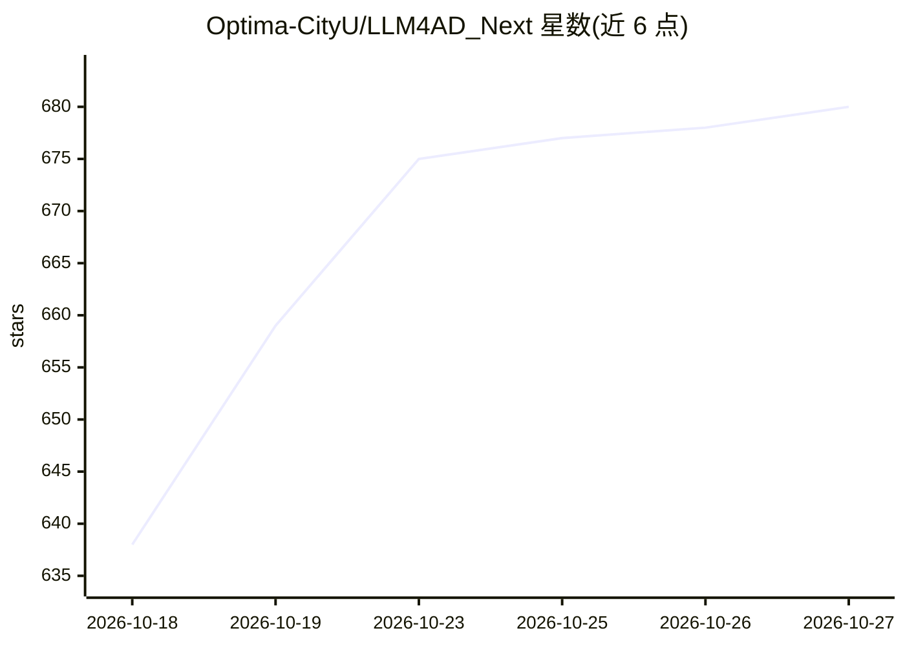

# Optima-CityU/LLM4AD_Next

⭐ 680 · Python · BSD-3-Clause · 推送 2026-10-26 · [GitHub](https://github.com/Optima-CityU/LLM4AD_Next) · [官网](https://llm4ad-next.cn) · 组织维护 · 中文 README

**用 LLM 与进化搜索自动设计算法的平台，一条命令生成可运行搜索**

LLM 驱动的自动算法设计平台：通过交互式对话终端（llm4ad chat）将自然语言问题描述转化为可运行的进化算法搜索项目，自动生成评估器、算法骨架、配置与调试器。内置 IslandGA、EoH、ReEvo、MCTS-AHD 等多种搜索方法编排器，并提供供编码 agent 使用的算法设计技能（SKILL.md）。支持全局 provider 配置（如 OpenAI）、MindMemOS 长期记忆、版本化 Docker 镜像与在线试用站点。本地安装需 Python 3.12+ 与 uv/pip。

## 筛选速览

| 维度 | 判定 | 备注 |
|---|---|---|
| AI 角色 | `ai-ecosystem` | LLM/agent 周边工具 |
| 许可风险 | `permissive` | BSD-3-Clause |
| 部署形态 | `library` | 以包/库形式分发 |
| 模型依赖 | — | README 未给出锁定关系 |
| 硬件要求 | — | 无带数字的原话,不猜 |
| 安装摩擦 | `low` | 无编译、无系统依赖或容器化 |
| 成熟度 | — | 结构信号不足 |

## 能力要点

- 对话式终端从问题描述自动生成可运行搜索管线（评估器/骨架/配置）
- 多种搜索方法编排器：IslandGA、EoH、MEoH、ReEvo、MCTS-AHD、DyCA 等
- Evolve-Block Advisor：扫描任意仓库并推荐最值得进化的代码块
- 供编码 agent 使用的模块化算法设计技能与 AlphaEvolve 数学基准用例

## 适用场景

- 把组合优化/数学问题交给 LLM+进化搜索自动设计求解算法
- 比较多种自动启发式设计方法在同一问题上的表现
- 在浏览器中无安装试用问题到算法的完整流程

## 场景标签

`代码生成` · 领域:编码与开发

## 证据(README 行号)

> L3:  From problem description to runnable evolutionary algorithm search — in one command.
> L56: * 🧠 **LLM-Powered Design** & 🧬 **Evolutionary Optimization** combined to automatically evolve top-performing code.
> L167: Requires **Python 3.12+** (pinned in `.python-version`) and uv (recommended) or pip. A plain `uv sync` sets up eve

## 星数曲线

2026-10-18 638 → 2026-10-27 680（+42）

---
*卡片 v1 · prompt 1.4 · 生成 2026-10-22 · 置信度 high · 依据 README sha `33bf5a18575f` · [字段定义](../../DATASET.md)*
