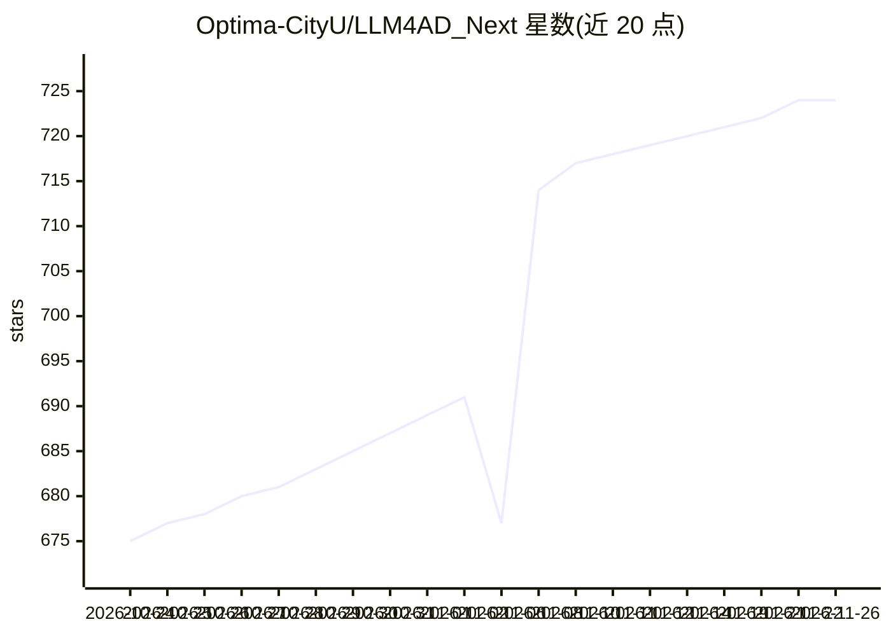

# Optima-CityU/LLM4AD_Next

⭐ 724 · Python · BSD-3-Clause · 推送 2026-11-23 · [GitHub](https://github.com/Optima-CityU/LLM4AD_Next) · [官网](https://llm4ad-next.cn) · 组织维护 · 中文 README

**LLM 驱动的自动算法设计平台：一句话生成可运行的进化算法搜索**

面向自动算法设计（LLM4AD）的 Python 平台，将自然语言问题描述转化为可运行的进化算法搜索项目。内置交互式配置流程 `llm4ad chat`，由 AI 顾问采集需求并生成评估器、算法骨架、配置与调试器；支持多种 AHD 搜索方法（IslandGA、Diverse Island GA、EoH、MEoH、ReEvo、MCTS-AHD、DyCA）作为独立编排器，并提供面向 coding agent 的算法设计技能（SKILL.md）。需 Python 3.12+，提供在线演示、PyPI 包与 Docker 部署镜像，部分搜索方法仍处于 Pending 状态。

## 筛选速览

| 维度 | 判定 | 备注 |
|---|---|---|
| AI 角色 | `ai-native` | 本体是模型或模型工具 |
| 许可风险 | `permissive` | BSD-3-Clause |
| 部署形态 | `library` | 以包/库形式分发 |
| 模型依赖 | — | README 未给出锁定关系 |
| 硬件要求 | — | 无带数字的原话,不猜 |
| 安装摩擦 | `low` | 无编译、无系统依赖或容器化 |
| 成熟度 | — | 结构信号不足 |

## 能力要点

- 交互式 chat 流程自动生成评估器、算法骨架、配置与调试器
- 多种进化搜索方法可配置切换（eoh/meoh/reevo/mcts_ahd/dyca 等）
- 提供 SKILL.md 格式的算法设计技能供 coding agent 调用
- 含 AlphaEvolve 数学基准套件（11 个可独立运行的优化案例）

## 适用场景

- 把优化问题描述直接转化为可运行的进化算法搜索项目
- 在 TSP 等任务上用 EoH 等方法自动演化启发式算法
- 让 coding agent 读取技能文件自主设计并运行算法
- 在数学基准案例上复现并对比演化结果

## 场景标签

`代码生成` · 领域:编码与开发

## 证据(README 行号)

> L4:  LLM-driven automated algorithm design with evolutionary optimization
> L59: * 🧠 **LLM-Powered Design** & 🧬 **Evolutionary Optimization** combined to automatically evolve top-performing code.
> L191: Requires **Python 3.12+** (pinned in `.python-version`) and uv (recommended) or pip. A plain `uv sync` sets up eve

## 星数曲线

2026-10-24 675 → 2026-11-26 724（+49）

---
*卡片 v1 · prompt 1.4 · 生成 2026-11-24 · 置信度 high · 依据 README sha `7d489acb3b91` · [字段定义](../../DATASET.md)*
