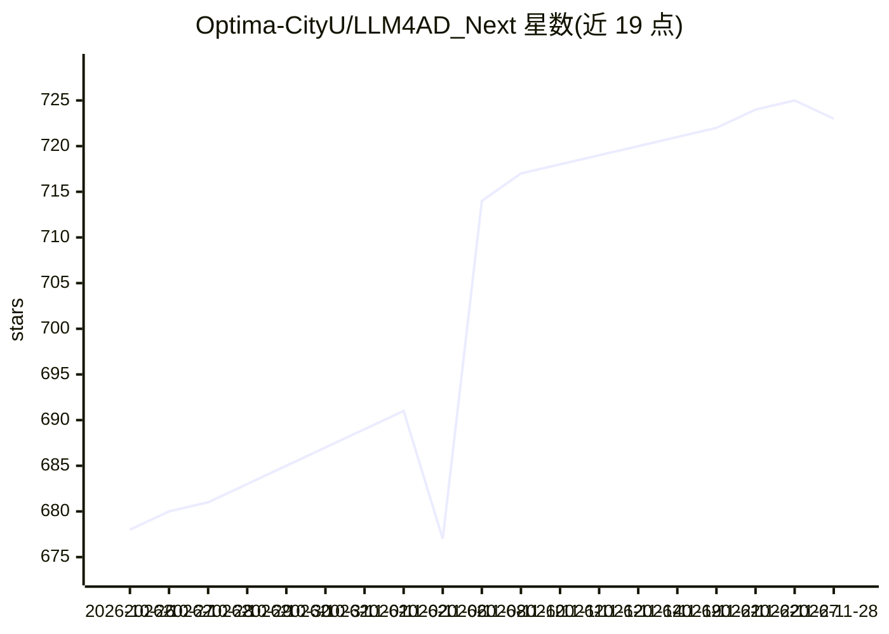

# Optima-CityU/LLM4AD_Next

⭐ 723 · Python · BSD-3-Clause · 推送 2026-11-27 · [GitHub](https://github.com/Optima-CityU/LLM4AD_Next) · [官网](https://llm4ad-next.cn) · 组织维护 · 中文 README

**用 LLM+进化优化自动设计算法的研究平台**

LLM4AD_Next 提供从问题描述到可运行进化算法搜索的工作流：内置 llm4ad chat 交互式顾问，根据自然语言需求生成评估器、算法骨架、配置与调试器；支持 IslandGA、EoH、ReEvo、MCTS-AHD、Diverse Island GA 等搜索方法编排器，并提供可交给 coding agent 的算法设计技能（SKILL.md）。附带 AlphaEvolve 数学基准套件、Evolve-Block 推荐器、AutoResearch 研究工作流与长期记忆功能。面向科研与算法工程人员，可通过在线站点免安装使用，本地需 Python 3.12+ 与 uv/pip。

## 筛选速览

| 维度 | 判定 | 备注 |
|---|---|---|
| AI 角色 | `ai-native` | 本体是模型或模型工具 |
| 许可风险 | `permissive` | BSD-3-Clause |
| 部署形态 | `library` | 以包/库形式分发 |
| 模型依赖 | — | README 未给出锁定关系 |
| 硬件要求 | — | 无带数字的原话,不猜 |
| 安装摩擦 | `low` | 无编译、无系统依赖或容器化 |
| 成熟度 | — | 结构信号不足 |

## 能力要点

- 交互式 llm4ad chat 从自然语言问题生成可运行搜索管线
- 提供 EoH、ReEvo、MCTS-AHD、Diverse Island GA 等搜索方法编排器
- 算法设计技能（SKILL.md）可被 coding agent 直接调用
- AlphaEvolve 数学基准套件含 11 个可独立运行的优化案例

## 适用场景

- 为组合优化问题（如 TSP）自动演化启发式算法
- 在数学基准上复现并对比进化搜索结果
- 让 coding agent 依据技能定义自主设计算法求解器

## 场景标签

`编码 Agent` `科研工具` `模型评测` · 领域:编码与开发

## 证据(README 行号)

> L4:  LLM-driven automated algorithm design with evolutionary optimization
> L55: Our built-in AI-powered consultant will interview you, instantly understand your requirements, and automatically ge
> L59: * 🧠 **LLM-Powered Design** & 🧬 **Evolutionary Optimization** combined to automatically evolve top-performing code.

## 星数曲线

2026-10-26 678 → 2026-11-28 723（+45）

---
*卡片 v1 · prompt 1.4 · 生成 2026-11-27 · 置信度 high · 依据 README sha `390d4934b2d6` · [字段定义](../../DATASET.md)*
