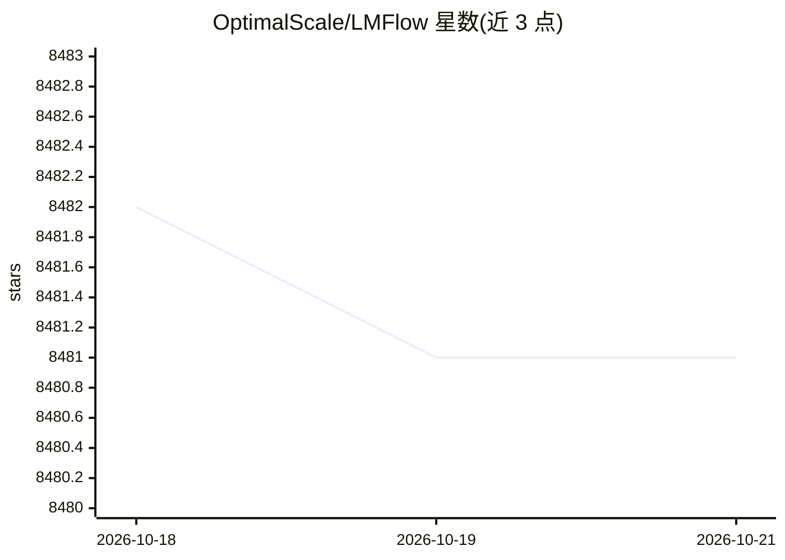

# OptimalScale/LMFlow

⭐ 8,481 · Python · Apache-2.0 · 推送 2026-08-10 · [GitHub](https://github.com/OptimalScale/LMFlow) · [官网](https://optimalscale.github.io/LMFlow/) · 组织维护 · 中文 README

**面向社区的大模型微调与推理工具箱，支持全量/LoRA/LISA/DPO**

LMFlow 是一个用于大基础模型微调与推理的可扩展工具箱，提供全量微调、LoRA、QLoRA、LISA、DPO 等训练方法，以及基于 HuggingFace 后端的推理、SGLang/vLLM 后端推理和 Gradio 聊天机器人部署。功能按 extras 可选安装，训练过程默认用 WandB 跟踪并可禁用。在 Ubuntu 20.04 上测试，其他操作系统未充分测试；README 给出不同模型规模与方法的显存需求表。以源码 + pip install -e 方式安装，曾提供 PyPI 包 lmflow-finetune。

## 筛选速览

| 维度 | 判定 | 备注 |
|---|---|---|
| AI 角色 | `ai-ecosystem` | LLM/agent 周边工具 |
| 许可风险 | `permissive` | Apache-2.0 |
| 部署形态 | `library` | 以包/库形式分发 |
| 模型依赖 | local-ok | 支持本地模型 |
| 硬件要求 | — | 无带数字的原话,不猜 |
| 安装摩擦 | `medium` | 含编译或系统依赖之一 |
| 成熟度 | — | 结构信号不足 |

## 能力要点

- 支持全量微调、LoRA、QLoRA、LISA（7B 训练 24G 显存）与 DPO
- 可选 extras 架构：vllm/sglang/trl/deepspeed/flash_attn/ray/multimodal/gradio/flask
- 提供 Llama-3/Phi-3 等对话模板与流式输出
- 基于 Accelerate 的分布式训练与多语言 README

## 适用场景

- 在消费级/单卡 GPU 上用 LISA 或 LoRA 微调开源大模型
- 微调后用脚本直接对话推理，并以 Gradio 部署聊天机器人
- 结合 vLLM 或 SGLang 后端做批量推理

## 场景标签

`微调` `推理引擎` · 领域:训练与推理

## 证据(README 行号)

> L20: An extensible, convenient, and efficient toolbox for finetuning large machine learning models, designed to be user-
> L81: |`vllm`|vLLM-backed inference and iterative DPO|`pip install -e ".[vllm]"`|
> L160: #### Full Finetuning

## 星数曲线

2026-10-18 8,482 → 2026-10-21 8,481（-1）

---
*卡片 v1 · prompt 1.4 · 生成 2026-10-20 · 置信度 mid · 依据 README sha `2352a300afeb` · [字段定义](../../DATASET.md)*
