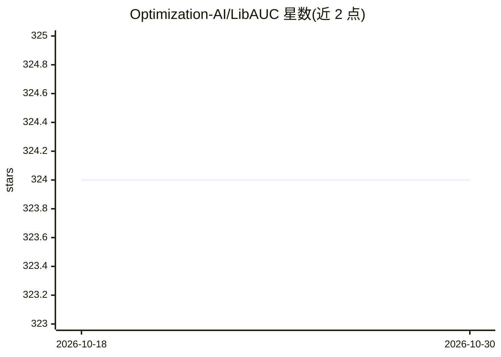

# Optimization-AI/LibAUC

⭐ 324 · Python · MIT · 推送 2026-08-21 · [GitHub](https://github.com/Optimization-AI/LibAUC) · [官网](https://libauc.org/) · 组织维护

**面向 X-Risk 优化的深度学习损失与优化器库**

LibAUC 是基于 PyTorch 的深度学习库，围绕 X-Risk 优化提供统一框架：涵盖不平衡数据分类（AUROC/AUPRC/partial AUC 代理损失）、学习排序（NDCG/top-K NDCG/listwise）与对比学习（全局对比损失）等组合损失函数及配套优化器。2.0 版本加入 LibAUC Trainer、全优化器分布式训练支持、Hugging Face 模型集成与极端分类等新优化器。面向做模型训练与度量优化的研究者和开发者，提供 pip 安装、文档网站与大量教程示例（含医学影像、表格、联邦学习场景）。

## 筛选速览

| 维度 | 判定 | 备注 |
|---|---|---|
| AI 角色 | `ai-native` | 本体是模型或模型工具 |
| 许可风险 | `permissive` | MIT |
| 部署形态 | `library` | 以包/库形式分发 |
| 模型依赖 | — | README 未给出锁定关系 |
| 硬件要求 | — | 无带数字的原话,不猜 |
| 安装摩擦 | `low` | 无编译、无系统依赖或容器化 |
| 成熟度 | — | 结构信号不足 |

## 能力要点

- 提供 AUROC/AUPRC/partial AUC/NDCG/全局对比损失等代理损失与配套优化器
- LibAUC Trainer、分布式训练与训练恢复支持
- Hugging Face 模型集成（2.0 版）
- 教程覆盖 CheXpert 胸片、皮肤癌、信用欺诈、联邦学习等应用

## 适用场景

- 直接优化 AUROC/AUPRC 等度量的不平衡分类任务
- 学习排序与极端分类模型的损失函数选型
- 对比学习表示训练（如 SogCLR/CLIP 类损失）

## 场景标签

`模型训练` · 领域:训练与推理

## 证据(README 行号)

> L1: LibAUC: A Deep Learning Library for X-Risk Optimization
> L38: LibAUC offers an easier way to directly optimize commonly-used performance measures and losses with user-friendly A

## 星数曲线

2026-10-18 324 → 2026-10-30 324（+0）

---
*卡片 v1 · prompt 1.4 · 生成 2026-10-21 · 置信度 high · 依据 README sha `c716956928c8` · [字段定义](../../DATASET.md)*
