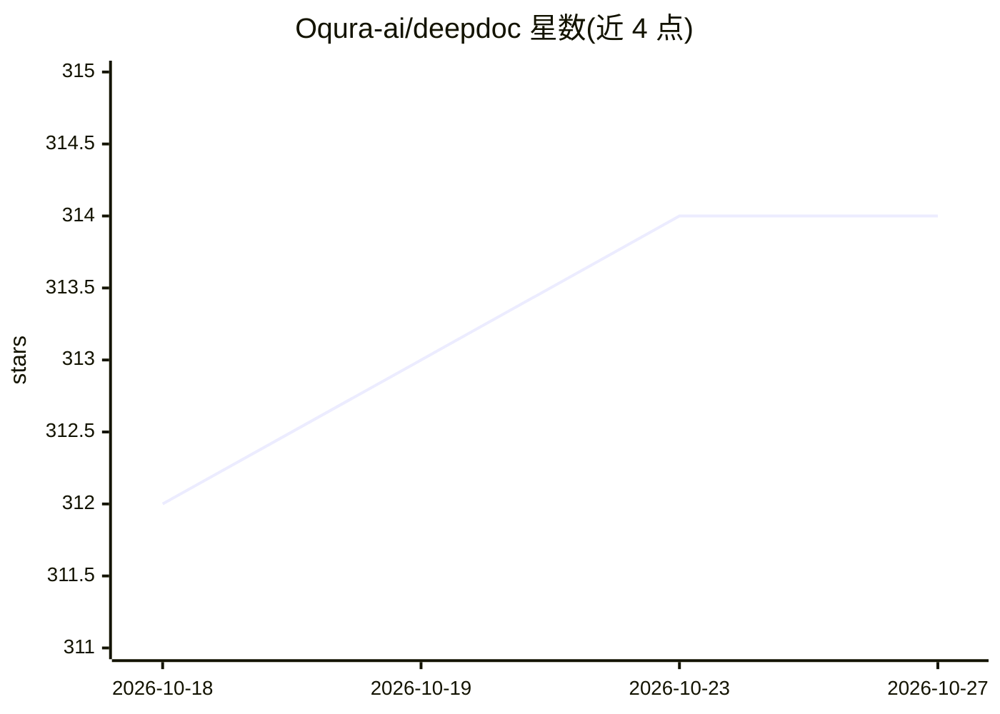

# Oqura-ai/deepdoc

⭐ 314 · Python · MIT · 推送 2026-09-26 · [GitHub](https://github.com/Oqura-ai/deepdoc) · 组织维护

**把本地文件转成结构化 Markdown 研究报告的深度研究工具**

面向拥有本地文档资料的用户：提供 PDF/DOCX/PPTX/图片/TXT/Markdown 目录后，工具抽取文本、保留页码与来源元数据并在 Qdrant 建索引；由报告规划器生成章节结构（用户可审批修改），每个章节一个研究 agent 生成查询、检索候选片段，用 TypeSafe Jev 模型做相关性判断、证据过滤与重排序，并以反思分数驱动补查缺失证据，最终由配置的生成 LLM 合成 Markdown 报告。默认配置需 OPENAI_API_KEY 与 TYPESAFE_API_KEY，Qdrant 通过 Docker Compose 启动。Jev 阈值需在代表性文档上校准，属可调参数而非固定值。

## 筛选速览

| 维度 | 判定 | 备注 |
|---|---|---|
| AI 角色 | `ai-native` | 本体是模型或模型工具 |
| 许可风险 | `permissive` | MIT |
| 部署形态 | `self-host` | docker 或自建部署 |
| 模型依赖 | — | README 未给出锁定关系 |
| 硬件要求 | — | 无带数字的原话,不猜 |
| 安装摩擦 | `low` | 无编译、无系统依赖或容器化 |
| 成熟度 | — | 结构信号不足 |

## 能力要点

- 每个报告章节一个研究 agent，生成查询并在本地 Qdrant 检索
- Jev 对候选片段做相关性/可用证据/矛盾/提示注入式内容判断并重排序
- Jev 反思分数驱动缺失证据补查，直至达到反思上限
- 报告结构先由规划器生成，用户审批后才开始研究

## 适用场景

- 把公司/个人的本地文档库转成一份带引用结构的主题报告
- 研究前先审批章节大纲，控制报告覆盖范围
- 对本地资料做多章节并行深度研究并导出 Markdown

## 场景标签

`科研工具` `文档问答` · 领域:知识与检索

## 证据(README 行号)

> L29: Oqura's deepdoc is a local deep-research tool that turns your own files into a
> L55:  - Writes the completed section from the accepted local evidence.

## 星数曲线

2026-10-18 312 → 2026-10-27 314（+2）

---
*卡片 v1 · prompt 1.4 · 生成 2026-10-21 · 置信度 mid · 依据 README sha `66cc8e3d2f26` · [字段定义](../../DATASET.md)*
