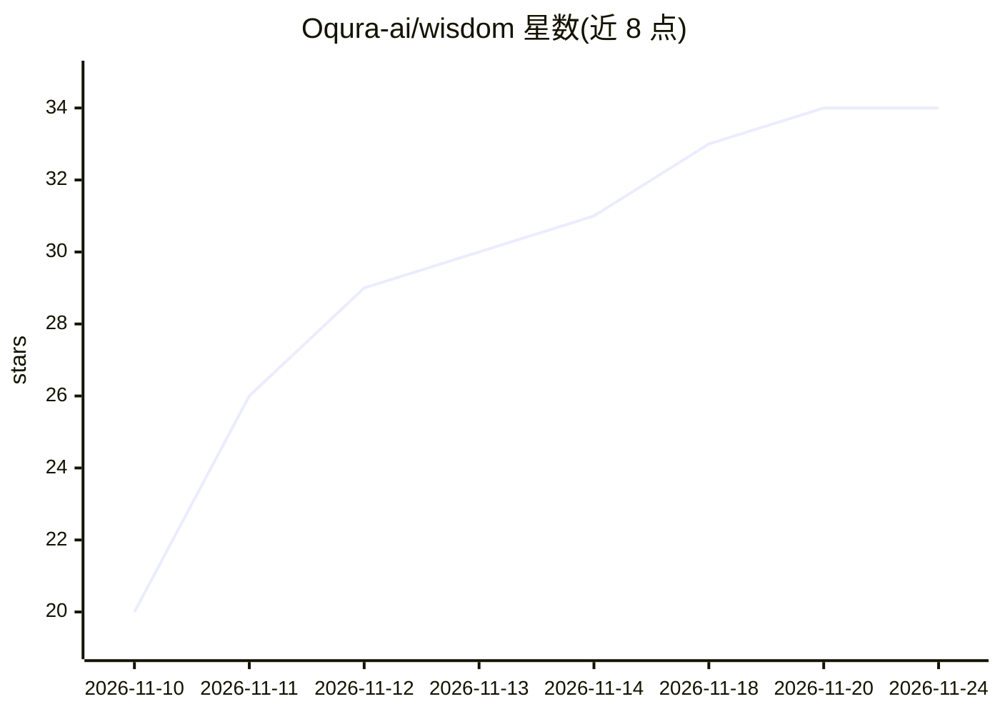

# Oqura-ai/wisdom

⭐ 34 · TypeScript · Apache-2.0 · 推送 2026-11-22 · [GitHub](https://github.com/Oqura-ai/wisdom) · [官网](https://wisdom.oqura.xyz) · 组织维护

**给开发者的编码代理会话记录与意图溯源工具**

Wisdom 是一个 npm 全局安装的本地工具：通过 hooks/extension 记录 Claude Code、Codex CLI 和 Pi 的编码代理会话，将每次文件变更与产生它的请求、推理和命令关联，保存到项目 .wisdom/ 目录（SQLite、diff、transcript 副本）并在提交时写入 .git 记录。提供本地 dashboard 浏览会话、跨代理查询技能（glance/open）、commit 溯源、由模型生成的提交指南、基于 git hidden refs 的团队模式与 CI 检查。隐私上记录本地保存，分享/导出前做密钥脱敏；自述为 Early 阶段，团队模式仅测试过 GitHub。

## 筛选速览

| 维度 | 判定 | 备注 |
|---|---|---|
| AI 角色 | `ai-ecosystem` | LLM/agent 周边工具 |
| 许可风险 | `permissive` | Apache-2.0 |
| 部署形态 | `library` | 以包/库形式分发 |
| 模型依赖 | — | README 未给出锁定关系 |
| 硬件要求 | — | 无带数字的原话,不猜 |
| 安装摩擦 | `low` | 无编译、无系统依赖或容器化 |
| 成熟度 | `idea` | |

## 能力要点

- 统一记录 Claude Code / Codex CLI / Pi 三种代理会话并逐轮浏览
- commit 级溯源：从代码行回溯到写入它的会话轮次
- 跨代理查询技能与 handoff 命令，下一个代理可读取上一会话
- 团队模式经自有 git remote 同步会话，CI 可检查代理提交是否有指南

## 适用场景

- 回看代理改动背后的请求与推理，确认变更是否有意为之
- 在 PR/issue 中导出会话记录供评审
- 团队间交接：不同成员用不同代理也能互读对方会话

## 场景标签

`LLM 可观测性` · 领域:评测与运维

## 证据(README 行号)

> L10: Wisdom records Claude Code, Codex and Pi sessions on your machine and links every file change to the request, the r
> L25:  Claude Code, Codex CLI and Pi send events through hooks or an extension to a local daemon on 127.0.0.1, which save
> L98: Wisdom puts a skill in each connected agent that teaches it two moves: `glance` to see a session's turns, and `open

## 星数曲线

2026-11-10 20 → 2026-11-24 34（+14）

---
*卡片 v1 · prompt 1.4 · 生成 2026-11-18 · 置信度 high · 依据 README sha `bf572a70a65e` · [字段定义](../../DATASET.md)*
