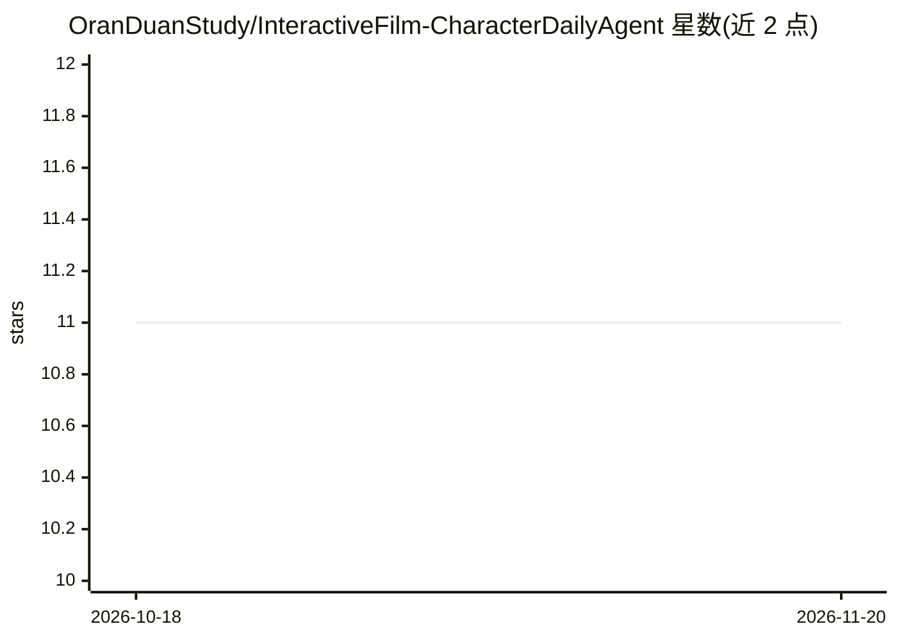

# OranDuanStudy/InteractiveFilm-CharacterDailyAgent

⭐ 11 · Python · MIT · 推送 2026-03-23 · [GitHub](https://github.com/OranDuanStudy/InteractiveFilm-CharacterDailyAgent) · 个人维护

**AI 角色日程与视频内容生成流水线：从角色创建到视频产出**

基于 LLM 的角色内容生成系统，覆盖角色创建、日程规划、事件规划、导演脚本到视频表演生成的完整工作流。日程规划由 Gemini 2.5 Pro 驱动并带能量/心情数值系统；支持 R/SR 两级分支叙事事件；生成逐镜头导演脚本（含台词与镜头设计）；调用图像与视频生成模型产出成片。提供 CLI 与移动端优先的 WebUI 两种交互方式，带超时自动重试，支持 Cloudflare Tunnel 部署，MIT 许可。

## 筛选速览

| 维度 | 判定 | 备注 |
|---|---|---|
| AI 角色 | `ai-native` | 本体是模型或模型工具 |
| 许可风险 | `permissive` | MIT |
| 部署形态 | `library` | 以包/库形式分发 |
| 模型依赖 | — | README 未给出锁定关系 |
| 硬件要求 | — | 无带数字的原话,不猜 |
| 安装摩擦 | `low` | 无编译、无系统依赖或容器化 |
| 成熟度 | — | 结构信号不足 |

## 能力要点

- Gemini 2.5 Pro 驱动的日程规划与能量/心情/亲密度属性系统
- nano_banana/seedream（图像）+ sora2/kling（视频）四种模型组合
- R/SR 两级交互事件系统与逐镜头导演脚本生成
- 9:16 移动端优先 WebUI 与一键流水线脚本

## 适用场景

- 为虚拟角色自动生成每日日程与剧情事件
- 批量生成分镜脚本并转为视频表演
- 在 WebUI 中与角色进行分支叙事互动

## 场景标签

`视频生成` `多模态` `图像生成` · 领域:内容生成

## 证据(README 行号)

> L11: An AI-driven system that implements a complete workflow from **character creation** → **schedule planning** → **eve
> L45: - 🤖 **AI Schedule Planning** — Gemini 2.5 Pro driven, with smart energy & mood system
> L48: - 🎥 **Multi-Model Video Generation** — nano_banana / seedream (image) + sora2 / kling (video)

## 星数曲线

2026-10-18 11 → 2026-11-20 11（+0）

---
*卡片 v1 · prompt 1.4 · 生成 2026-11-19 · 置信度 high · 依据 README sha `582b4fd916ed` · [字段定义](../../DATASET.md)*
