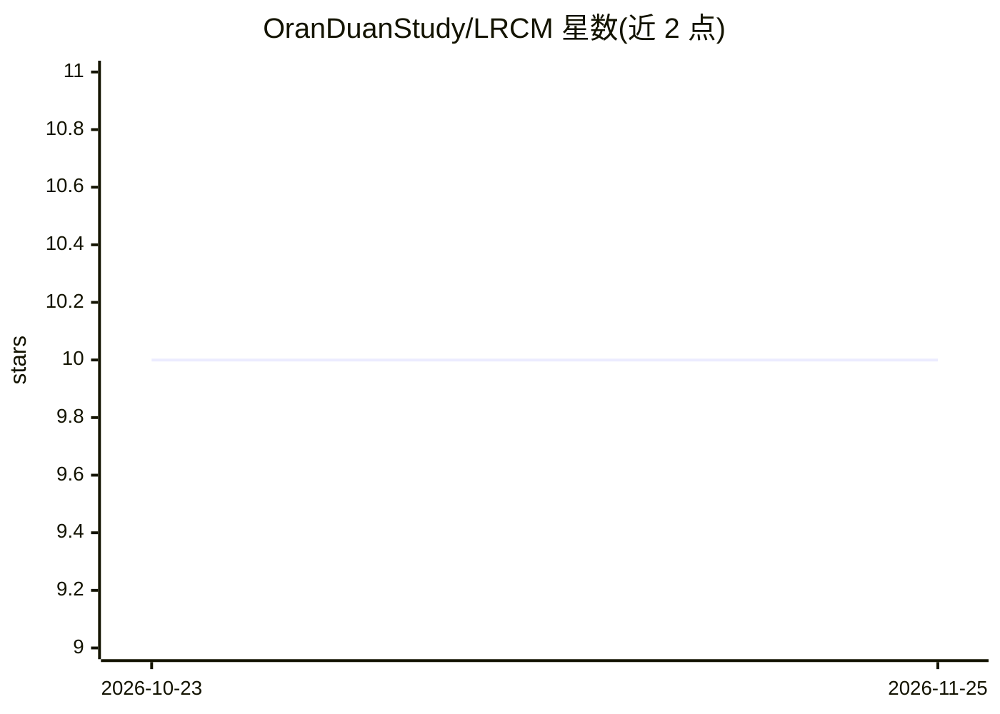

# OranDuanStudy/LRCM

⭐ 10 · Python · MIT · 推送 2026-03-25 · [GitHub](https://github.com/OranDuanStudy/LRCM) · 个人维护

**音频节奏+分层文本驱动的舞蹈动作生成模型**

研究项目：以音频节奏与分层文本描述（全局风格+局部动作）为条件，通过扩散模型与 Mamba 状态空间模块生成舞蹈动作序列，支持 7 种舞种与自回归长序列合成。提供三阶段训练脚本、NAR/AR 两版预训练 checkpoint、文本标注数据集下载（需另行下载 Motorica 动捕数据）及推理命令。要求 Python 3.10+、CUDA 12.x、4×RTX 4090，硬件门槛较高。

## 筛选速览

| 维度 | 判定 | 备注 |
|---|---|---|
| AI 角色 | `ai-native` | 本体是模型或模型工具 |
| 许可风险 | `permissive` | MIT |
| 部署形态 | `library` | 以包/库形式分发 |
| 模型依赖 | — | README 未给出锁定关系 |
| 硬件要求 | — | 无带数字的原话,不猜 |
| 安装摩擦 | `medium` | 含编译或系统依赖之一 |
| 成熟度 | — | 结构信号不足 |

## 能力要点

- 音频节奏+分层文本双模态条件控制
- 基于 Mamba SSM 的自回归长序列生成
- 支持 7 种舞种（Hip-hop/Jazz/Krump 等）
- 提供 NAR/AR 两版预训练 checkpoint 与三阶段训练流程

## 适用场景

- 根据音乐节奏与文字描述生成舞蹈动作序列
- 研究扩散模型+Mamba 的长序列动作生成
- 复现论文中三阶段训练实验

## 场景标签

`多模态` · 领域:感知与多模态

## 证据(README 行号)

> L12: **LRCM** is a multimodal-guided diffusion framework for dance motion generation that simultaneously leverages **aud
> L34: - 🎵 **Dual-modality conditioning**: Audio rhythm + Text descriptions (global + local)
> L46: **Requirements:** Python 3.10+, CUDA 12.x, PyTorch 2.4+, 4× RTX 4090 (24GB)

## 星数曲线

2026-10-23 10 → 2026-11-25 10（+0）

---
*卡片 v1 · prompt 1.4 · 生成 2026-11-20 · 置信度 high · 依据 README sha `28914dffa301` · [字段定义](../../DATASET.md)*
