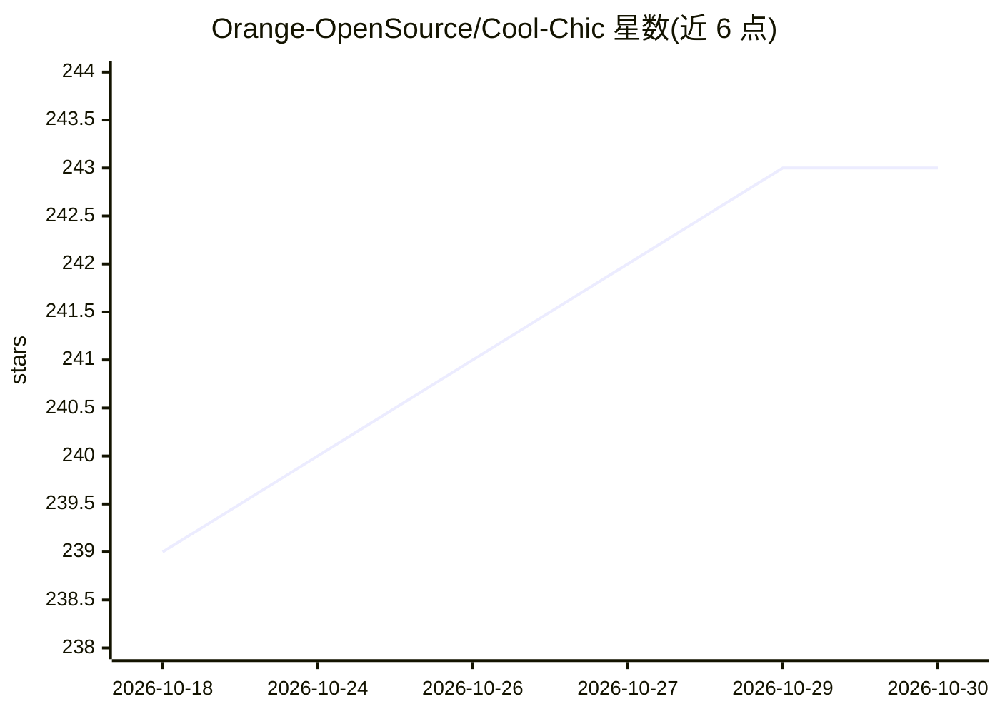

# Orange-OpenSource/Cool-Chic

⭐ 243 · Python · BSD-3-Clause · 推送 2026-07-17 · [GitHub](https://github.com/Orange-OpenSource/Cool-Chic) · [官网](https://orange-opensource.github.io/Cool-Chic/) · 组织维护

**低复杂度神经图像/视频编解码器，基于过拟合实现压缩**

基于过拟合（overfitting）的低复杂度神经图像与视频编解码器，由 Orange 开源。5.0 版本聚焦图像编码，相对 4.2 版本编码速度提升 10 倍、同等质量下码率下降 10%，解码复杂度为每像素 2000 次乘加。通过 git clone 源码安装，提供 cc_encode.py / cc_decode.py 脚本编码图像与视频、解码输出 PNG 或 YUV。依赖 PyTorch 训练框架，使用 constriction 库做区间编码，附论文可引用。

## 筛选速览

| 维度 | 判定 | 备注 |
|---|---|---|
| AI 角色 | `ai-native` | 本体是模型或模型工具 |
| 许可风险 | `permissive` | BSD-3-Clause |
| 部署形态 | `None` |  |
| 模型依赖 | — | README 未给出锁定关系 |
| 硬件要求 | — | 无带数字的原话,不猜 |
| 安装摩擦 | `low` | 无编译、无系统依赖或容器化 |
| 成熟度 | — | 结构信号不足 |

## 能力要点

- 过拟合式神经编解码，解码仅需约 2000 MAC/像素
- 5.0 版本编码速度较 4.2 提升 10 倍、码率下降 10%
- 支持图像与视频（逐帧）编码，输出 PNG/YUV

## 适用场景

- 压缩图像或视频并生成码流文件
- 研究神经编解码器的率失真性能
- 对比神经编码与传统编码（如 VVC）性能

## 场景标签

 · 领域:多媒体编码/神经压缩

## 证据(README 行号)

> L18: Cool-chic (pronounced /kul ʃik/ as in French 🥖🧀🍷) is
> L19: a low-complexity neural image and video codec based on overfitting. It achieves state-of-the-art image compression 

## 星数曲线

2026-10-18 239 → 2026-10-30 243（+4）

---
*卡片 v1 · prompt 1.4 · 生成 2026-10-22 · 置信度 high · 依据 README sha `b8d897687055` · [字段定义](../../DATASET.md)*
