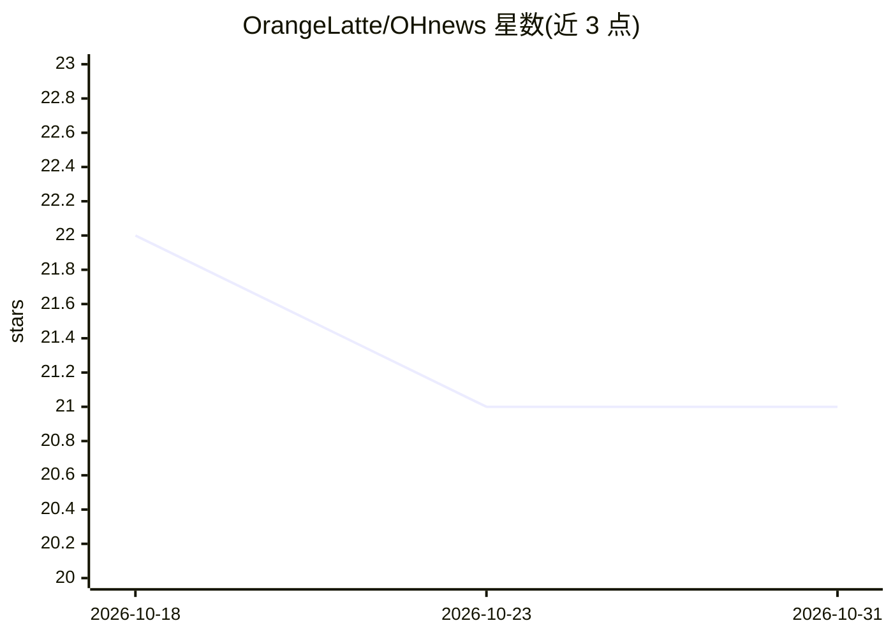

# OrangeLatte/OHnews

⭐ 21 · Python · MIT · 推送 2026-09-18 · [GitHub](https://github.com/OrangeLatte/OHnews) · 个人维护 · 中文 README

**自托管的证据优先新闻工作台：对比官方与市场叙事框架**

自托管新闻分析工作区：从 RSS/GDELT/FRED 采集约两周 5,000 篇中英文报道，产出叙事分歧指数（NDI，带 bootstrap 置信区间）、可点击回溯到原句的证据、按实体的变更追踪与只追加的判断时间线。内部机制包括三层模型路由（DeepSeek/智谱 GLM，JSON-schema 门控）、18 类元素结构化抽取并锚定字符区间、无 API key 时降级为词典引擎。限制：单用户、非商业研究版，搜索为子串匹配、批量采集非流式。一键脚本启动，附演示语料，MIT 许可。

## 筛选速览

| 维度 | 判定 | 备注 |
|---|---|---|
| AI 角色 | `ai-native` | 本体是模型或模型工具 |
| 许可风险 | `permissive` | MIT |
| 部署形态 | `library` | 以包/库形式分发 |
| 模型依赖 | — | README 未给出锁定关系 |
| 硬件要求 | — | 无带数字的原话,不猜 |
| 安装摩擦 | `low` | 无编译、无系统依赖或容器化 |
| 成熟度 | — | 结构信号不足 |

## 能力要点

- NDI 叙事分歧度量（Jeffreys 平滑 + JS 距离 + bootstrap 置信区间，不可测时弃权）
- 所有 AI 抽取元素锚定字符区间，高亮即原文引用而非转述
- 无 API key 时词典引擎端到端运行，降级结果标注 engine=offline
- LangGraph agent 带 interrupt() 人工确认门与 SQLite 检查点回放

## 适用场景

- 对比同一事件下官方与市场媒体的叙事差异
- 追踪某实体或议题自上次查看以来的变化
- 记录并回放自己立场变化的时间线，不被系统改写

## 场景标签

 · 领域:新闻情报/媒体分析

## 证据(README 行号)

> L3: **Evidence-first news workspace** — see how official and market media frame the same event
> L13: **Output:** one working loop — divergence signals with confidence intervals, evidence you can
> L26: |Official vs market narrative divergence|✗|✗|✓ NDI with bootstrap CI (abstains when unmeasurable)|

## 星数曲线

2026-10-18 22 → 2026-10-31 21（-1）

---
*卡片 v1 · prompt 1.4 · 生成 2026-10-28 · 置信度 mid · 依据 README sha `d99696f23140` · [字段定义](../../DATASET.md)*
