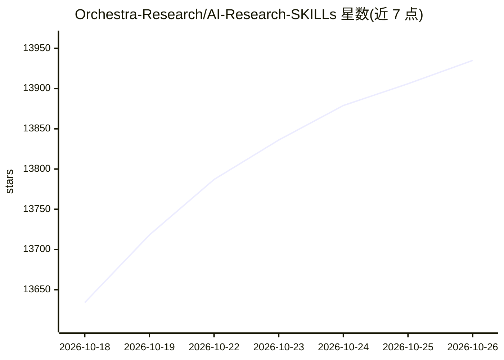

# Orchestra-Research/AI-Research-SKILLs

⭐ 13,935 · TeX · MIT · 推送 2026-10-11 · [GitHub](https://github.com/Orchestra-Research/AI-Research-SKILLs) · [官网](http://orchestra-research.com) · 组织维护

**面向 AI 研究者的 98 项 agent 技能库**

由 Orchestra Research 维护的开源技能库，收录 98 个覆盖 23 个类别的 AI 研究与工程技能，供 Claude Code、Gemini CLI、Cursor 等编码 agent 安装使用。技能覆盖自动研究编排（autoresearch 双循环架构）、模型架构、微调、后训练、分布式训练、推理、评测、RAG、多模态等，内容来自官方仓库与 GitHub issue。安装方式为 npx 交互式安装器（自动检测已装 agent 并以符号链接部署）或 Claude Code 插件市场。以 MIT 许可发布。

## 筛选速览

| 维度 | 判定 | 备注 |
|---|---|---|
| AI 角色 | `ai-native` | 本体是模型或模型工具 |
| 许可风险 | `permissive` | MIT |
| 部署形态 | `library` | 以包/库形式分发 |
| 模型依赖 | — | README 未给出锁定关系 |
| 硬件要求 | — | 无带数字的原话,不猜 |
| 安装摩擦 | `low` | 无编译、无系统依赖或容器化 |
| 成熟度 | — | 结构信号不足 |

## 动量与使用信号

- 维护:`active` — 距上次 push 7.2 天,年发版 10,16 位贡献者
- 涨星:近 1 天 **+36**(自 20261016 起算)
- 安装:npm 包 `@orchestra-research/ai-research-skills` 月下载 1,323
- 平台:WINDOWS · 协议:—

## 能力要点

- 98 个技能覆盖 23 个类别，含 autoresearch 双循环编排层
- npx 安装器自动检测已装编码 agent 并以符号链接部署到 ~/.orchestra/skills/
- 支持 Claude Code 插件市场安装
- 技能内容包含代码示例、排错指南与工作流文档

## 适用场景

- 让编码 agent 执行从选题到写论文的研究流程
- 为微调、分布式训练、推理部署等环节查阅框架使用指南
- 团队统一安装维护一套 AI 研究技能供多个 agent 使用

## 场景标签

`科研工具` `精选清单` · 领域:学习与行业

## 证据(README 行号)

> L33: We enable AI agents to **autonomously conduct AI research** — from literature survey and idea generation through ex
> L46:  - End-to-End Coverage - 98 skills spanning the full AI research lifecycle, from ideation and literature survey to 
> L71: - **Auto-detects** your installed coding agents (Claude Code, Hermes Agent, OpenCode, Qoder, Cursor, Gemini CLI, et

## 星数曲线

2026-10-18 13,634 → 2026-10-26 13,935（+301）

---
*卡片 v1 · prompt 1.4 · 生成 2026-10-18 · 置信度 high · 依据 README sha `a6c182510e65` · [字段定义](../../DATASET.md)*
