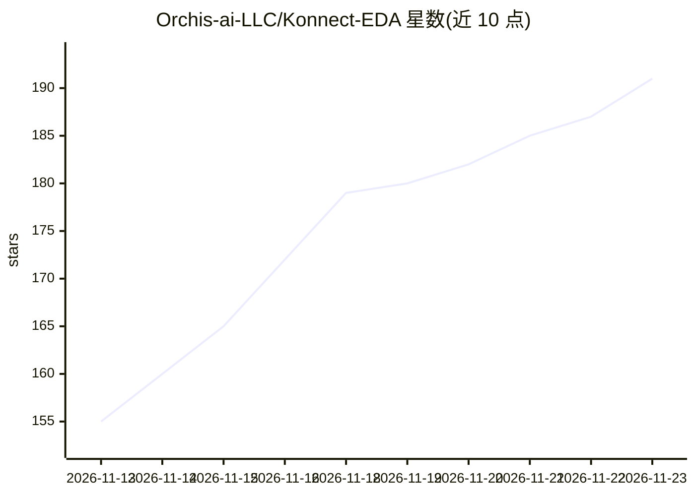

# Orchis-ai-LLC/Konnect-EDA

⭐ 191 · NOASSERTION · 推送 2026-11-21 · [GitHub](https://github.com/Orchis-ai-LLC/Konnect-EDA) · [官网](https://konnect-eda.orchis.ai) · 组织维护

**面向 KiCad 10 的 AI 辅助 PCB 设计 MCP 插件**

Orchis.ai LLC 开发的闭源商业 KiCad 10 原生插件，以单个 Rust 二进制形式提供 MCP 服务器，使 Claude、Codex 等 AI 助手能够直接绘制原理图、布局布线 PCB、执行 ERC/DRC 检查、导出生产文件、搜索 JLCPCB 元件库并使用参考电路模板。含 228 个工具、21 个工具集，原理图编辑直接改写 S 表达式文件，PCB 编辑走 KiCad IPC API。测试期免费，1.0 后个人/学生/爱好者免费，商业用途需付费许可。

## 筛选速览

| 维度 | 判定 | 备注 |
|---|---|---|
| AI 角色 | `ai-ecosystem` | LLM/agent 周边工具 |
| 许可风险 | `none` | NOASSERTION |
| 部署形态 | `desktop` | 安装包/桌面程序 |
| 模型依赖 | locked-api |  |
| 硬件要求 | — | 无带数字的原话,不猜 |
| 安装摩擦 | `low` | 无编译、无系统依赖或容器化 |
| 成熟度 | `idea` | |

## 能力要点

- 228 个工具、21 个按需工具集，覆盖原理图/PCB/检查/导出
- 通过 MCP (JSON-RPC over stdio 或 HTTP) 接入 Claude、Codex 等 AI 客户端
- KiCad 10 IPC API 实时 PCB 编辑，带撤销/重做集成
- 内置 Claude/Codex 的 KiCad 技能与 agent 指引，附自动刷新原理图查看器

## 适用场景

- 让 Claude/Codex 直接在我的 KiCad 项目里放元件、布线
- 自动跑 ERC/DRC 和电源、去耦等设计审查
- 按 JLCPCB 元件快照选型并导出 Gerber/BOM 等生产文件

## 场景标签

 · 领域:电子设计自动化（EDA）

## 证据(README 行号)

> L13: **Your AI designs the board. KiCad stays in charge.** Konnect-EDA is a native KiCad
> L15: design schematics and PCBs through the Model Context Protocol
> L14: plugin — a single Rust binary — that lets Claude, Codex and other AI assistants

## 星数曲线

2026-11-13 155 → 2026-11-23 191（+36）

---
*卡片 v1 · prompt 1.4 · 生成 2026-11-17 · 置信度 high · 依据 README sha `9082d0a2ae0e` · [字段定义](../../DATASET.md)*
