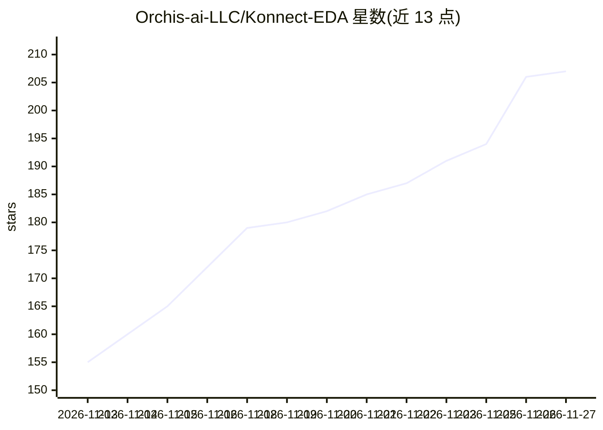

# Orchis-ai-LLC/Konnect-EDA

⭐ 207 · NOASSERTION · 推送 2026-11-21 · [GitHub](https://github.com/Orchis-ai-LLC/Konnect-EDA) · [官网](https://konnect-eda.orchis.ai) · 组织维护

**让 Claude/Codex 通过 MCP 直接设计 KiCad PCB 的闭源插件**

以单个 Rust 二进制分发的 KiCad 10 原生插件，通过 MCP 提供 228 个工具、21 个按需工具集：AI 可放置并连线原理图元件、经 KiCad IPC API 实时布局布线、运行 ERC/DRC 与设计审查、检索 JLCPCB 元件库、套用参考电路模板并导出 Gerber/BOM 等生产文件。传输支持 stdio 与 HTTP，本地运行、无遥测；KiCad 10 为必需依赖，Windows 测试最充分，个人使用免费、企业需商业许可。

## 筛选速览

| 维度 | 判定 | 备注 |
|---|---|---|
| AI 角色 | `ai-native` | 本体是模型或模型工具 |
| 许可风险 | `none` | NOASSERTION |
| 部署形态 | `desktop` | 安装包/桌面程序 |
| 模型依赖 | locked-api |  |
| 硬件要求 | — | 无带数字的原话,不猜 |
| 安装摩擦 | `low` | 无编译、无系统依赖或容器化 |
| 成熟度 | `idea` | |

## 能力要点

- 228 个工具覆盖原理图、布局布线、ERC/DRC 与制造导出全流程
- 通过 KiCad 官方 IPC API 与 kicad-cli 工作，产出普通 KiCad 工程
- 本地运行，无遥测、无更新检查
- 捆绑面向 Claude 与 Codex 的 skills/agents，经 konnect init 安装

## 适用场景

- 让 AI 助手在 KiCad 中完成原理图绘制与 PCB 布局布线
- 对现有设计自动执行 ERC/DRC 与设计审查
- 从 USB-C、 buck 等参考电路模板快速起步
- 检索 JLCPCB 元件并导出生产文件

## 场景标签

 · 领域:EDA/电子设计自动化

## 证据(README 行号)

> L13: **Your AI designs the board. KiCad stays in charge.** Konnect-EDA is a native KiCad
> L15: design schematics and PCBs through the Model Context Protocol
> L18: **228 tools across 21 on-demand toolsets.** Schematic capture, PCB layout and

## 星数曲线

2026-11-13 155 → 2026-11-27 207（+52）

---
*卡片 v1 · prompt 1.4 · 生成 2026-11-25 · 置信度 high · 依据 README sha `165bcfd6cbd0` · [字段定义](../../DATASET.md)*
