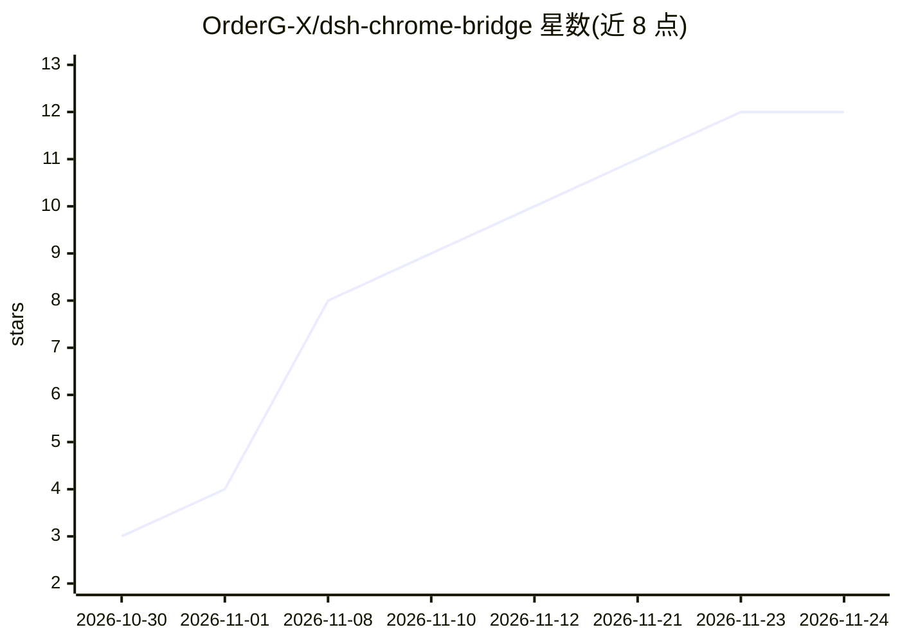

# OrderG-X/dsh-chrome-bridge

⭐ 12 · JavaScript · MIT · 推送 2026-11-20 · [GitHub](https://github.com/OrderG-X/dsh-chrome-bridge) · [官网](https://chromewebstore.google.com/detail/bippcbbbipppmhjkjomgdnjbooecbimo) · 个人维护 · 中文 README

**让 DSH agent 操控你现有 Chrome 的浏览器桥接插件**

DSH (DeepSeek Harness) 的浏览器插件：通过 Chrome 原生消息管道与 chrome.debugger（真实 CDP Input 事件）连接本地 Node 宿主，无需端口监听和每次点击 Connect，为 agent 提供 12 个 browser_* 工具（标签页、读取、点击、输入、截图、拖拽、下载、DevTools 等），复用用户已有登录态。页面内绘制可见光标并出现在截图中；被操作的标签页归入独立标签组，支持暂停与逐会话隔离。以 npm 包形式通过 DSH 插件页安装，需 Chrome 116+ 与 Node.js 18+。

## 筛选速览

| 维度 | 判定 | 备注 |
|---|---|---|
| AI 角色 | `ai-ecosystem` | LLM/agent 周边工具 |
| 许可风险 | `permissive` | MIT |
| 部署形态 | `None` |  |
| 模型依赖 | locked-api |  |
| 硬件要求 | — | 无带数字的原话,不猜 |
| 安装摩擦 | `low` | 无编译、无系统依赖或容器化 |
| 成熟度 | — | 结构信号不足 |

## 能力要点

- 12 个 browser_* 原生工具，覆盖导航/点击/表单/截图/拖拽/下载/DevTools
- 原生消息管道 + 0600 Unix socket 令牌，无 TCP 端口监听
- 真实 CDP Input 事件带用户手势，弹窗与焦点行为正常
- 页面内可见光标与 DSH 工作标签组，操作过程可观察可暂停

## 适用场景

- 让 agent 帮我填写网页表单并提交
- 用已有登录态检查后台管理页面并截图
- 抓取页面控制台报错与网络请求排查问题
- 用登录身份下载发票/报表等文件

## 场景标签

`浏览器自动化` · 领域:效率与自动化

## 证据(README 行号)

> L17: > **What it is:** a DeepSeek Harness (DSH) plugin that lets the model operate the Chrome you already use: open page
> L47: DSH's agent  (provided by the harness — this repo ships none)
> L53: **This repo ships no agent** — the agent above is DSH's own; we only give it hands.

## 星数曲线

2026-10-30 3 → 2026-11-24 12（+9）

---
*卡片 v1 · prompt 1.4 · 生成 2026-11-20 · 置信度 high · 依据 README sha `a4075a87e90f` · [字段定义](../../DATASET.md)*
