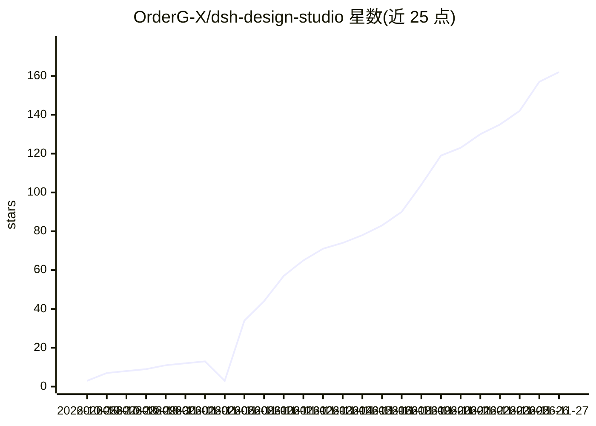

# OrderG-X/dsh-design-studio

⭐ 162 · JavaScript · MIT · 推送 2026-11-25 · [GitHub](https://github.com/OrderG-X/dsh-design-studio) · 个人维护 · 中文 README

**给 DSH 用户的设计画布插件：一句话生成界面并点选修改**

作为 DeepSeek Harness（DSH）的插件运行：用户描述需求后，模型在画布上生成网页、App、小程序、桌面软件等界面并套设备框，可点选元素用自然语言修改、三方向并排挑选、逐屏导出展示图/PDF/PPT、转成 React/Vue/uni-app 代码。附设计检查、模拟数据、组件抽取、版本对比、模板市场等机制。依赖 DSH 桌面版或网页版，「设计检查」需本机装有 Chrome 或 Edge；需在 DSH 插件页手动启用。

## 筛选速览

| 维度 | 判定 | 备注 |
|---|---|---|
| AI 角色 | `ai-native` | 本体是模型或模型工具 |
| 许可风险 | `permissive` | MIT |
| 部署形态 | `None` |  |
| 模型依赖 | — | README 未给出锁定关系 |
| 硬件要求 | — | 无带数字的原话,不猜 |
| 安装摩擦 | `low` | 无编译、无系统依赖或容器化 |
| 成熟度 | — | 结构信号不足 |

## 能力要点

- 点选画布元素后用自然语言修改，支持画圈/箭头标注交给模型
- 设计检查：查文字溢出、对比度、按钮与字号问题并标记在页面
- 导出展示图/PDF/PPT/可交互 HTML 演示，可转 React/Vue/uni-app 代码
- 模板市场从 npm 镜像取目录，签名校验后使用，支持断网开关

## 适用场景

- 一句话生成会员 App、民宿官网等界面原型并逐屏修改
- 把设计稿转成 React/Vue/小程序代码交付开发
- 生成申报书技术路线图、产品路线图导出 PNG/PDF
- 给 DSH 设计插件界面时预览桌面端外壳效果

## 场景标签

`代码生成` `AI 助手` · 领域:编码与开发

## 证据(README 行号)

> L10: **设计工作台**是 DeepSeek Harness（DSH）的插件：说一句要做什么，模型做的网页、App 界面、小程序、桌面软件、海报、幻灯片、思维导图和路线图在右边画布上一屏屏长出来，套着手机、浏览器或软件窗口的设备框。看中
> L26: 1. 在设计模式里说一句要做什么，比如「帮我设计一个社区健身房的会员 App」。也可以直接在设计台首页的大输入框里说：挑个类型、风格，点 ↑ 就发出去（没写字时按 Tab 用例子）。

## 星数曲线

2026-10-25 3 → 2026-11-27 162（+159）

---
*卡片 v1 · prompt 1.4 · 生成 2026-11-27 · 置信度 high · 依据 README sha `6a0fd3820bed` · [字段定义](../../DATASET.md)*
