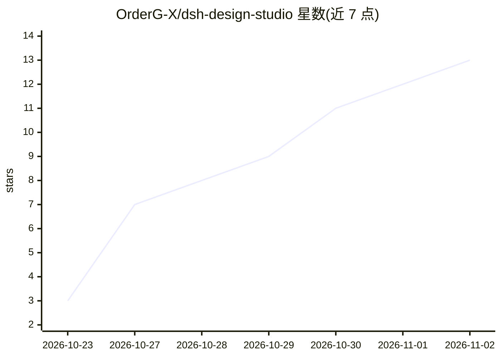

# OrderG-X/dsh-design-studio

⭐ 13 · JavaScript · MIT · 推送 2026-10-31 · [GitHub](https://github.com/OrderG-X/dsh-design-studio) · 个人维护 · 中文 README

**DeepSeek Harness 的设计工作台插件：画布预览界面、点选改稿**

DeepSeek Harness（DSH）的插件：模型生成网页、App 界面、海报、幻灯片时，右侧栏画布实时显示每一屏并套手机/浏览器外框；点选元素或拖区域后整理成文字进输入框，由模型改源码。每轮自动存版本、支持左右对比与回退，可导出图片/PDF/PPT，手机扫码真机预览。附设计体检（对比度、溢出、点击区等实测）、品牌设计系统提取、handoff 转代码逐像素比对。以 npm 包经 DSH 插件页安装，装后需重启 DSH；仅预览本机页面，无头体检依赖本机 Chrome/Edge。

## 筛选速览

| 维度 | 判定 | 备注 |
|---|---|---|
| AI 角色 | `ai-ecosystem` | LLM/agent 周边工具 |
| 许可风险 | `permissive` | MIT |
| 部署形态 | `None` |  |
| 模型依赖 | locked-api |  |
| 硬件要求 | — | 无带数字的原话,不猜 |
| 安装摩擦 | `low` | 无编译、无系统依赖或容器化 |
| 成熟度 | — | 结构信号不足 |

## 能力要点

- 多屏画布实时预览，按 web/app/海报/幻灯片等类型套设备外框
- 点选/拖选元素生成结构化描述进输入框，模型照源码修改
- 每轮自动存版本（最多 40 版），支持左右对比与回退
- check_design 无头浏览器实测设计与 WCAG 对比度，附截图交模型修复
- 导出图片/PDF/PPT，PDF/PPT 内跳转可点，手机扫码真机预览

## 适用场景

- 让模型做落地页/App 界面时在画布上逐屏查看并口头迭代
- 生成后自动体检文字溢出、对比度不足等问题并交模型修复
- 把设计稿交接成 React/Vue/Next 代码并逐像素比对验收

## 场景标签

`代码生成` · 领域:编码与开发

## 证据(README 行号)

> L10: > **一句话**：DeepSeek Harness（DSH）插件，模型做网页、App 界面、海报、幻灯片时，右侧栏画布实时显示每一屏，套上手机 / 浏览器外框；点一下元素或框一块区域，补一句话就改。每轮自动存版本，能导出展示图、
> L46: 1. **做设计时自动打开**：模型加载了设计技能、调了 `preview_page`，或页面写了设计类型标记（`<meta name="dsh-design">`）之后，再写 `.html` 文件或用命令起开发服务器（`npm 
> L90: `preview_page` 工具的参数：`target`（文件路径 / 端口 / 地址）、`kind`（web / app / tablet / poster / slides / email）、`size`（如 `1080x1

## 星数曲线

2026-10-23 3 → 2026-11-02 13（+10）

---
*卡片 v1 · prompt 1.4 · 生成 2026-11-01 · 置信度 high · 依据 README sha `a6a04f8e3df1` · [字段定义](../../DATASET.md)*
