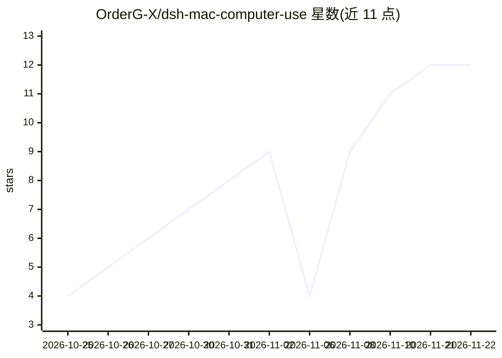

# OrderG-X/dsh-mac-computer-use

⭐ 12 · Swift · MIT · 推送 2026-11-12 · [GitHub](https://github.com/OrderG-X/dsh-mac-computer-use) · 个人维护 · 中文 README

**DSH 插件：让模型看屏幕截图操作 Mac 桌面**

DeepSeek Harness（DSH）的 macOS computer use 插件，通过 11 个 desktop_* 工具让模型依据截图操作桌面：列窗口、截图、OCR 按文字定位、元素编号点击、打字、按键、滚动、拖拽、启动应用。视觉优先路线，不依赖无障碍树（AX），在锁屏等 AX 失效场景下仍可用。安装包自带预编译通用二进制（Apple 芯片与 Intel，macOS 11+），无需编译；首次使用需授予屏幕录制与辅助功能权限。仅支持 macOS，需已安装 DSH。

## 筛选速览

| 维度 | 判定 | 备注 |
|---|---|---|
| AI 角色 | `ai-enhanced` | 去掉 AI 部分产品仍成立 |
| 许可风险 | `permissive` | MIT |
| 部署形态 | `None` |  |
| 模型依赖 | — | README 未给出锁定关系 |
| 硬件要求 | — | 无带数字的原话,不猜 |
| 安装摩擦 | `medium` | 含编译或系统依赖之一 |
| 成熟度 | — | 结构信号不足 |

## 能力要点

- 11 个 desktop_* 工具：窗口列表、截图、OCR 找字、点击、输入、按键、滚动、拖拽、启动应用
- OCR 用 macOS 自带 Vision 框架本地运行，desktop_observe 给可点元素编号供模型按序号点击
- 屏幕上有可操作的桌面光标浮层，60 秒空闲自退，不留常驻进程
- 预编译通用二进制分发，无需 clone 仓库或安装 Xcode

## 适用场景

- 让 AI 助手操作只有图形界面、没有命令行的 Mac 软件
- 对无障碍树失效或受限的环境做桌面自动化
- 通过自然语言查看屏幕内容并执行点击输入操作

## 场景标签

`GUI 自动化` · 领域:效率与自动化

## 证据(README 行号)

> L8: **给 DSH 的 Mac 桌面操作能力（computer use）。视觉优先，不依赖无障碍树。**
> L10: > **一句话**：DeepSeek Harness（DSH）插件，让模型看着屏幕操作你的 Mac：列窗口、截图、OCR 找字、点击、打字、按键、滚动、拖拽、打开应用。
> L14: > **安装**：DSH「插件」页 →「添加插件」，填 `dsh-mac-computer-use`（npm 包，连不上 npm 会自动换国内镜像），重启 DSH。安装包自带编好的程序（Apple 芯片和 Intel 都能用，ma

## 星数曲线

2026-10-25 4 → 2026-11-22 12（+8）

---
*卡片 v1 · prompt 1.4 · 生成 2026-11-18 · 置信度 high · 依据 README sha `dd2e9cd46b71` · [字段定义](../../DATASET.md)*
