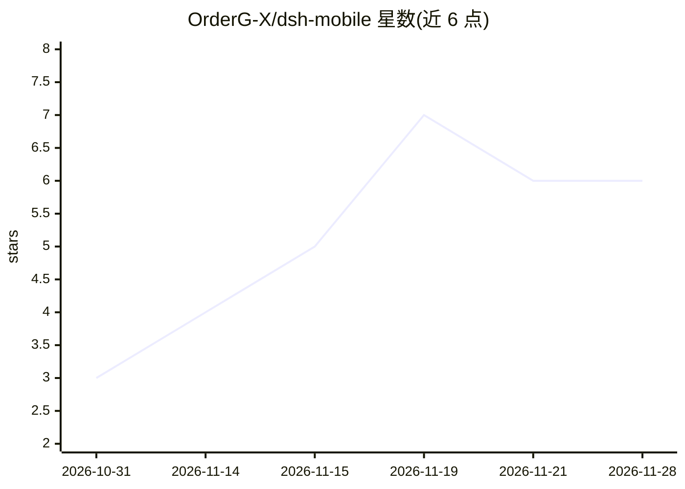

# OrderG-X/dsh-mobile

⭐ 6 · JavaScript · MIT · 推送 2026-11-24 · [GitHub](https://github.com/OrderG-X/dsh-mobile) · 个人维护 · 中文 README

**DSH 插件：手机扫码在浏览器里远程查看和操作电脑上的任务**

DeepSeek Harness（DSH）的插件，为电脑上运行的 DSH 提供手机远程访问：在 DSH 插件页按 npm 包名安装后，电脑端生成一次性二维码（10 分钟过期、单次有效），手机扫码后在浏览器中获得 DSH 网页界面，可查看任务进度、发送消息、点击批准，两端实时同步。外网访问走 Cloudflare 免费快速隧道（自动下载 cloudflared），可选配置 Bark/ntfy/Server酱/Webhook 推送。支持 macOS、Windows、Linux，无需安装 App 或注册账号。

## 筛选速览

| 维度 | 判定 | 备注 |
|---|---|---|
| AI 角色 | `ai-ecosystem` | LLM/agent 周边工具 |
| 许可风险 | `permissive` | MIT |
| 部署形态 | `None` |  |
| 模型依赖 | — | README 未给出锁定关系 |
| 硬件要求 | — | 无带数字的原话,不猜 |
| 安装摩擦 | `low` | 无编译、无系统依赖或容器化 |
| 成熟度 | — | 结构信号不足 |

## 能力要点

- 扫码配对，手机浏览器直接使用 DSH 官方网页界面
- Cloudflare 免费隧道实现外网访问，无需公网 IP
- 一次性二维码配对凭证，支持逐台移除设备
- 任务完成与待批准时的多渠道推送（Bark/ntfy/Server酱/Webhook）

## 适用场景

- 出门后用手机查看电脑上 DSH 任务进度
- 人不在电脑前时回复消息、批准任务
- 长时间任务跑完时接收手机通知

## 场景标签

`编码 Agent` · 领域:编码与开发

## 证据(README 行号)

> L14: > **一句话**：DeepSeek Harness（DSH）插件，在手机浏览器里用电脑上的 DSH：扫码后看任务进度、回消息、点批准。走免费的 Cloudflare 隧道，在外面用流量也能连，不用装 App。
> L84: 插件在 DSH 里起一个小网关（默认端口 18765），把手机的请求转给本机的 DSH 网页端。手机上跑的就是 DSH 官方网页界面，会话、设置都和电脑上一样。

## 星数曲线

2026-10-31 3 → 2026-11-28 6（+3）

---
*卡片 v1 · prompt 1.4 · 生成 2026-11-20 · 置信度 high · 依据 README sha `b8d21ce9b3bb` · [字段定义](../../DATASET.md)*
