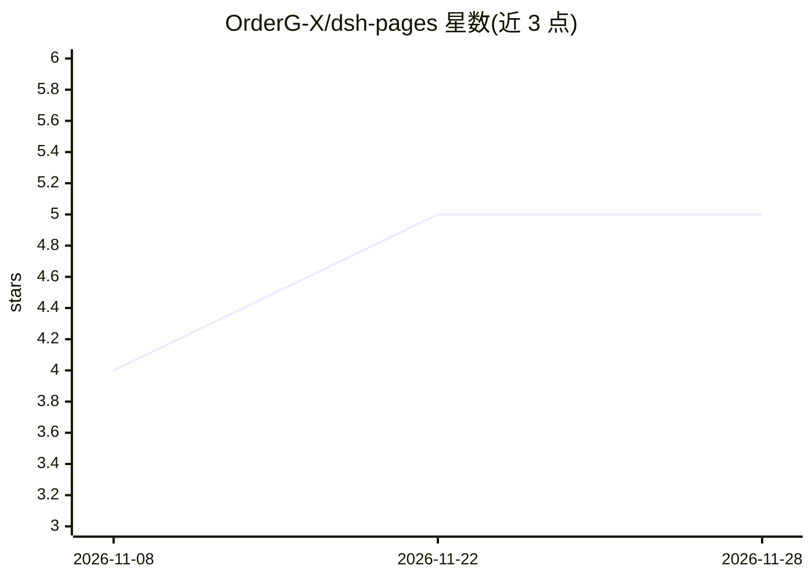

# OrderG-X/dsh-pages

⭐ 5 · JavaScript · MIT · 推送 2026-11-24 · [GitHub](https://github.com/OrderG-X/dsh-pages) · 个人维护 · 中文 README

**DSH 插件：让模型把回答生成可交互网页嵌在对话里**

DeepSeek Harness（DSH）的插件：模型调用 `show_page` 工具把回答做成一页网页，直接嵌在回复下方可点击交互，也可在右侧栏整页打开并导出 PNG/PDF/HTML。提供报告、对比、清单、看板、时间线、学习卡片、测验、流程图、思维导图、技术路线 10 种模板，模型只填内容；模板外的场景由模型写完整 HTML。页面跟随 DSH 深浅色主题、按版本保存、存盘后在无头 Chrome/Edge 中自动体检（脚本报错、溢出、深色适配等），结果回传给模型自我修正。页面运行在 CSP 沙箱中，不能联网取数据。

## 筛选速览

| 维度 | 判定 | 备注 |
|---|---|---|
| AI 角色 | `ai-native` | 本体是模型或模型工具 |
| 许可风险 | `permissive` | MIT |
| 部署形态 | `None` |  |
| 模型依赖 | — | README 未给出锁定关系 |
| 硬件要求 | — | 无带数字的原话,不猜 |
| 安装摩擦 | `low` | 无编译、无系统依赖或容器化 |
| 成熟度 | — | 结构信号不足 |

## 能力要点

- 10 种内置模板：模型只传 template 与 data，插件负责排版与交互
- 页面版本化保存，改一次存一版，旧版可翻回
- 存盘后在无头 Chrome/Edge 自动体检，结果与缩略图回传模型
- 深浅色切换不重载，表单内容保留；localStorage 按页持久化

## 适用场景

- 让 AI 回答以对比表、数据看板、时间线等网页形式呈现
- 做房贷计算器、学习卡片、测验这类可交互页面
- 生成页面的多版本管理与 PNG/PDF/HTML 导出

## 场景标签

`代码生成` · 领域:编码与开发

## 证据(README 行号)

> L12: 让 DSH（DeepSeek Harness）的模型把回答做成一页网页：对比、清单、图表、计算器、测验……页面**直接嵌在回复下面**，能点能用，深浅色跟着 DSH 走，填过的东西重开还在。改一次存一版，旧版留着能翻；右侧栏看整页
> L16: > **一句话**：DeepSeek Harness（DSH）插件，模型用 `show_page` 把回答做成一页，直接显示在对话里、能交互；10 种常用模板只写内容就行，跟随深浅色、有版本、存好自动体检、能导出。
> L55: 模型传 `template` 和 `data`（只写内容），插件排成一页：配色、深浅色、手机排版、交互和保存都是现成的。比让模型从头写整页网页快得多，也不会写坏；`data` 写得不对，工具会说清楚哪里不对，模型照着改。

## 星数曲线

2026-11-08 4 → 2026-11-28 5（+1）

---
*卡片 v1 · prompt 1.4 · 生成 2026-11-21 · 置信度 high · 依据 README sha `fa6cc6483f98` · [字段定义](../../DATASET.md)*
